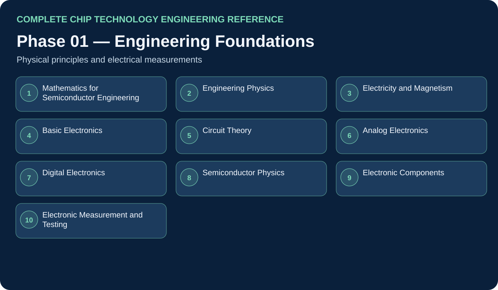

# Phase 01 — Engineering Foundations

**Scope:** Physical principles and electrical measurements. **Topics:** 10. These are compact reference briefs, not completed practical projects.

| # | Engineering subject | Practical checkpoint |
|---|---|---|
| 001 | [Mathematics for Semiconductor Engineering](topic-001-mathematics-for-semiconductor-engineering/README.md) | Plot axes and units |
| 002 | [Engineering Physics](topic-002-engineering-physics/README.md) | Check SI units |
| 003 | [Electricity and Magnetism](topic-003-electricity-and-magnetism/README.md) | Compare values at two distances |
| 004 | [Basic Electronics](topic-004-basic-electronics/README.md) | Calculate safe resistor current |
| 005 | [Circuit Theory](topic-005-circuit-theory/README.md) | Check against the divider equation |
| 006 | [Analog Electronics](topic-006-analog-electronics/README.md) | Identify clipping |
| 007 | [Digital Electronics](topic-007-digital-electronics/README.md) | Check all four input pairs |
| 008 | [Semiconductor Physics](topic-008-semiconductor-physics/README.md) | Label the band gap |
| 009 | [Electronic Components](topic-009-electronic-components/README.md) | Match component to role |
| 010 | [Electronic Measurement and Testing](topic-010-electronic-measurement-and-testing/README.md) | Specify measurement points |

**Publishing rule:** Add code, screenshots, diagrams and measured outcomes only when a real study or build has been performed. Existing 180-day curriculum is independent of this reference library.

[← Master phase index](../README.md)
