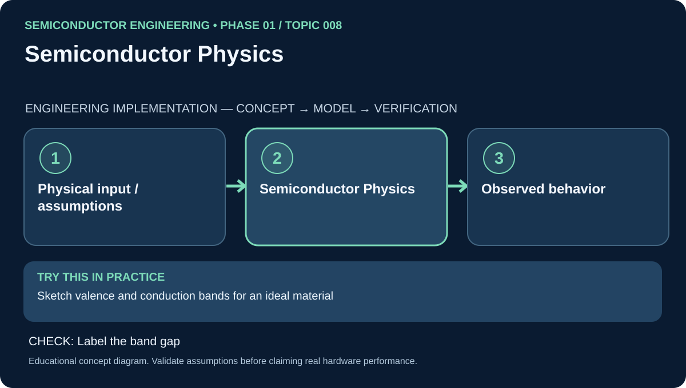

# 008. Semiconductor Physics

> **Phase 01 — Engineering Foundations** · Practical visual reference · **Status: reference / not implemented**

## What it does

Physical principles and electrical measurements. This topic concerns **semiconductor physics** and its role in designing, studying, testing or manufacturing chips.

## Practical viewpoint

**Try:** Sketch valence and conduction bands for an ideal material.

**Verify:** Label the band gap.

## Engineering flow

1. **Input:** Physical input / assumptions.
2. **Work:** Model / measurement; apply the method described in the exercise.
3. **Output:** Observed behavior; document the check and its assumptions.

**Evidence to upload later:** diagram, implementation or simulation, test results, and a short note on what was learned. This reference does not claim any work is finished.

[← Phase overview](../README.md) · [All phases](../../README.md)
