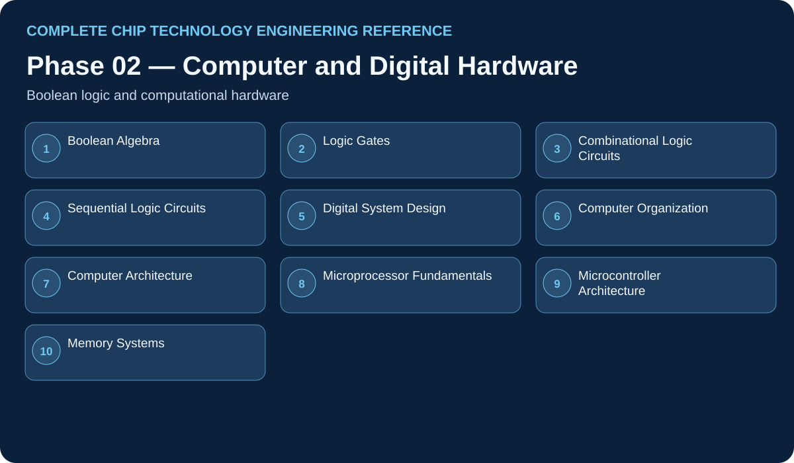

# Phase 02 — Computer and Digital Hardware

**Scope:** Boolean logic and computational hardware. **Topics:** 10. These are compact reference briefs, not completed practical projects.

| # | Engineering subject | Practical checkpoint |
|---|---|---|
| 011 | [Boolean Algebra](topic-011-boolean-algebra/README.md) | Compare both expressions |
| 012 | [Logic Gates](topic-012-logic-gates/README.md) | Print truth tables |
| 013 | [Combinational Logic Circuits](topic-013-combinational-logic-circuits/README.md) | Test every select/input case |
| 014 | [Sequential Logic Circuits](topic-014-sequential-logic-circuits/README.md) | Verify state changes only on the clock edge |
| 015 | [Digital System Design](topic-015-digital-system-design/README.md) | Separate control from data |
| 016 | [Computer Organization](topic-016-computer-organization/README.md) | Record state transitions |
| 017 | [Computer Architecture](topic-017-computer-architecture/README.md) | Count cycles and stalls |
| 018 | [Microprocessor Fundamentals](topic-018-microprocessor-fundamentals/README.md) | Verify instruction fields |
| 019 | [Microcontroller Architecture](topic-019-microcontroller-architecture/README.md) | Identify peripheral interfaces |
| 020 | [Memory Systems](topic-020-memory-systems/README.md) | Check bounds and read/write |

**Publishing rule:** Add code, screenshots, diagrams and measured outcomes only when a real study or build has been performed. Existing 180-day curriculum is independent of this reference library.

[← Master phase index](../README.md)
