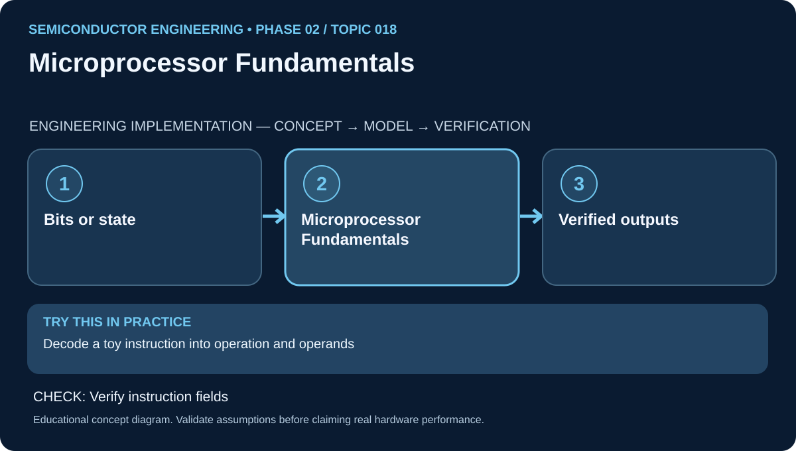

# 018. Microprocessor Fundamentals

> **Phase 02 — Computer and Digital Hardware** · Practical visual reference · **Status: reference / not implemented**

## What it does

Boolean logic and computational hardware. This topic concerns **microprocessor fundamentals** and its role in designing, studying, testing or manufacturing chips.

## Practical viewpoint

**Try:** Decode a toy instruction into operation and operands.

**Verify:** Verify instruction fields.

## Engineering flow

1. **Input:** Bits or state.
2. **Work:** Logic / architecture; apply the method described in the exercise.
3. **Output:** Verified outputs; document the check and its assumptions.

**Evidence to upload later:** diagram, implementation or simulation, test results, and a short note on what was learned. This reference does not claim any work is finished.

[← Phase overview](../README.md) · [All phases](../../README.md)
