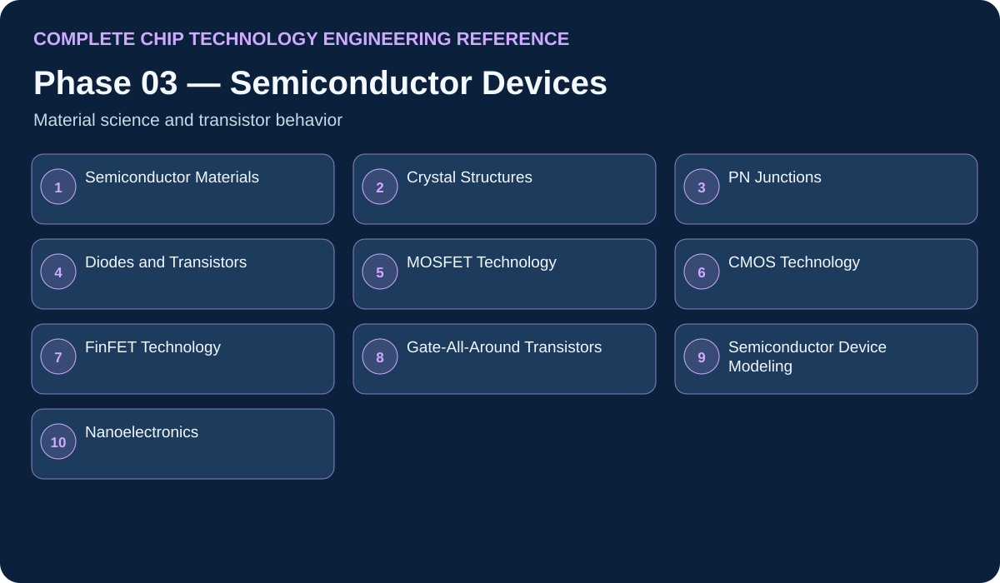

# Phase 03 — Semiconductor Devices

**Scope:** Material science and transistor behavior. **Topics:** 10. These are compact reference briefs, not completed practical projects.

| # | Engineering subject | Practical checkpoint |
|---|---|---|
| 021 | [Semiconductor Materials](topic-021-semiconductor-materials/README.md) | Identify tradeoffs |
| 022 | [Crystal Structures](topic-022-crystal-structures/README.md) | Label repeated unit cells |
| 023 | [PN Junctions](topic-023-pn-junctions/README.md) | Distinguish operating regions |
| 024 | [Diodes and Transistors](topic-024-diodes-and-transistors/README.md) | Identify controlled terminals |
| 025 | [MOSFET Technology](topic-025-mosfet-technology/README.md) | Label threshold assumptions |
| 026 | [CMOS Technology](topic-026-cmos-technology/README.md) | Verify complementary conduction |
| 027 | [FinFET Technology](topic-027-finfet-technology/README.md) | Label channel and gate contact |
| 028 | [Gate-All-Around Transistors](topic-028-gate-all-around-transistors/README.md) | Compare with FinFET |
| 029 | [Semiconductor Device Modeling](topic-029-semiconductor-device-modeling/README.md) | Report error and assumptions |
| 030 | [Nanoelectronics](topic-030-nanoelectronics/README.md) | Explain why variability matters |

**Publishing rule:** Add code, screenshots, diagrams and measured outcomes only when a real study or build has been performed. Existing 180-day curriculum is independent of this reference library.

[← Master phase index](../README.md)
