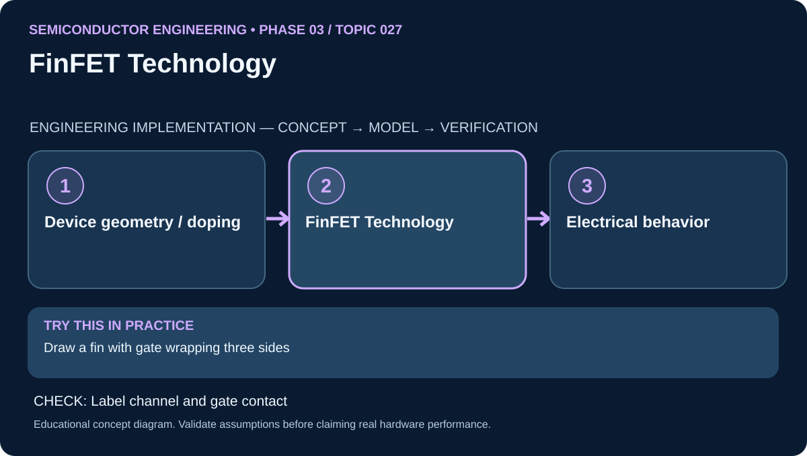

# 027. FinFET Technology

> **Phase 03 — Semiconductor Devices** · Practical visual reference · **Status: reference / not implemented**

## What it does

Material science and transistor behavior. This topic concerns **finfet technology** and its role in designing, studying, testing or manufacturing chips.

## Practical viewpoint

**Try:** Draw a fin with gate wrapping three sides.

**Verify:** Label channel and gate contact.

## Engineering flow

1. **Input:** Device geometry / doping.
2. **Work:** Material or device model; apply the method described in the exercise.
3. **Output:** Electrical behavior; document the check and its assumptions.

**Evidence to upload later:** diagram, implementation or simulation, test results, and a short note on what was learned. This reference does not claim any work is finished.

[← Phase overview](../README.md) · [All phases](../../README.md)
