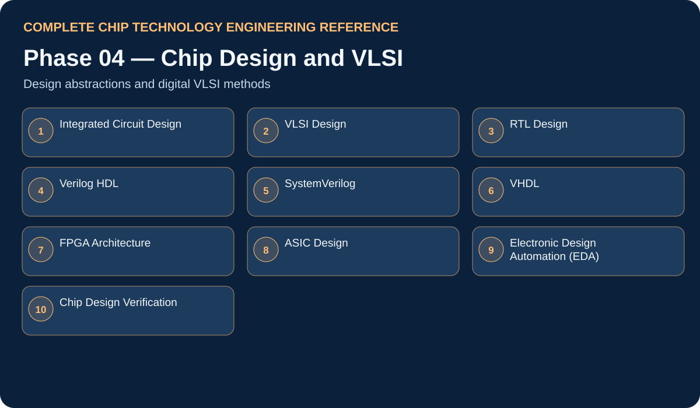

# Phase 04 — Chip Design and VLSI

**Scope:** Design abstractions and digital VLSI methods. **Topics:** 10. These are compact reference briefs, not completed practical projects.

| # | Engineering subject | Practical checkpoint |
|---|---|---|
| 031 | [Integrated Circuit Design](topic-031-integrated-circuit-design/README.md) | Name ports and power rails |
| 032 | [VLSI Design](topic-032-vlsi-design/README.md) | State design assumptions |
| 033 | [RTL Design](topic-033-rtl-design/README.md) | Describe clock and reset |
| 034 | [Verilog HDL](topic-034-verilog-hdl/README.md) | Check 0/1 inputs |
| 035 | [SystemVerilog](topic-035-systemverilog/README.md) | Cover positive and negative tests |
| 036 | [VHDL](topic-036-vhdl/README.md) | Compare simulation behavior |
| 037 | [FPGA Architecture](topic-037-fpga-architecture/README.md) | Identify logic versus wiring |
| 038 | [ASIC Design](topic-038-asic-design/README.md) | Define inputs, outputs and clocks |
| 039 | [Electronic Design Automation (EDA)](topic-039-electronic-design-automation-eda/README.md) | Identify each artifact |
| 040 | [Chip Design Verification](topic-040-chip-design-verification/README.md) | Enumerate corner cases |

**Publishing rule:** Add code, screenshots, diagrams and measured outcomes only when a real study or build has been performed. Existing 180-day curriculum is independent of this reference library.

[← Master phase index](../README.md)
