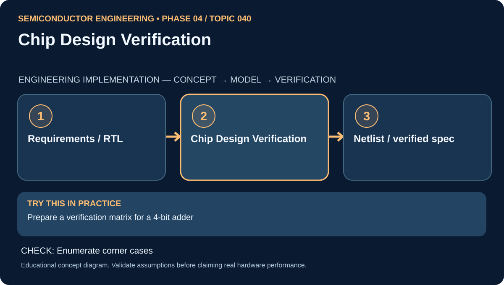

# 040. Chip Design Verification

> **Phase 04 — Chip Design and VLSI** · Practical visual reference · **Status: reference / not implemented**

## What it does

Design abstractions and digital VLSI methods. This topic concerns **chip design verification** and its role in designing, studying, testing or manufacturing chips.

## Practical viewpoint

**Try:** Prepare a verification matrix for a 4-bit adder.

**Verify:** Enumerate corner cases.

## Engineering flow

1. **Input:** Requirements / RTL.
2. **Work:** Design and EDA workflow; apply the method described in the exercise.
3. **Output:** Netlist / verified spec; document the check and its assumptions.

**Evidence to upload later:** diagram, implementation or simulation, test results, and a short note on what was learned. This reference does not claim any work is finished.

[← Phase overview](../README.md) · [All phases](../../README.md)
