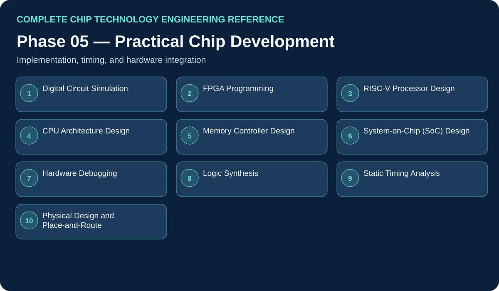

# Phase 05 — Practical Chip Development

**Scope:** Implementation, timing, and hardware integration. **Topics:** 10. These are compact reference briefs, not completed practical projects.

| # | Engineering subject | Practical checkpoint |
|---|---|---|
| 041 | [Digital Circuit Simulation](topic-041-digital-circuit-simulation/README.md) | Compare expected and observed |
| 042 | [FPGA Programming](topic-042-fpga-programming/README.md) | Include debouncing assumptions |
| 043 | [RISC-V Processor Design](topic-043-risc-v-processor-design/README.md) | Verify register updates |
| 044 | [CPU Architecture Design](topic-044-cpu-architecture-design/README.md) | Name control signals |
| 045 | [Memory Controller Design](topic-045-memory-controller-design/README.md) | Test simultaneous requests |
| 046 | [System-on-Chip (SoC) Design](topic-046-system-on-chip-soc-design/README.md) | Label address mapping |
| 047 | [Hardware Debugging](topic-047-hardware-debugging/README.md) | Write a minimal failing test |
| 048 | [Logic Synthesis](topic-048-logic-synthesis/README.md) | Inspect gate count |
| 049 | [Static Timing Analysis](topic-049-static-timing-analysis/README.md) | Identify failing paths |
| 050 | [Physical Design and Place-and-Route](topic-050-physical-design-and-place-and-route/README.md) | Note congestion and wire delay |

**Publishing rule:** Add code, screenshots, diagrams and measured outcomes only when a real study or build has been performed. Existing 180-day curriculum is independent of this reference library.

[← Master phase index](../README.md)
