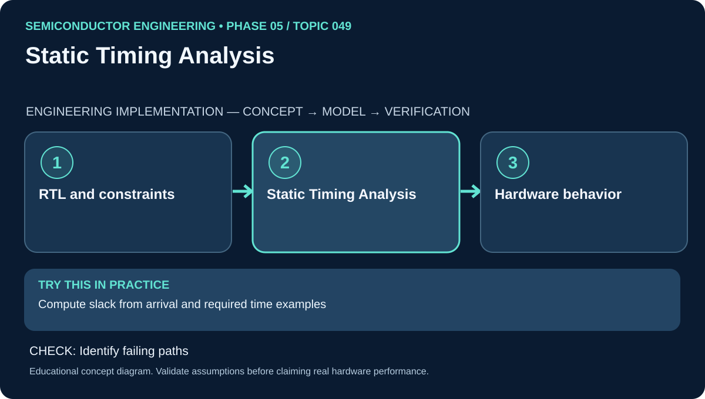

# 049. Static Timing Analysis

> **Phase 05 — Practical Chip Development** · Practical visual reference · **Status: reference / not implemented**

## What it does

Implementation, timing, and hardware integration. This topic concerns **static timing analysis** and its role in designing, studying, testing or manufacturing chips.

## Practical viewpoint

**Try:** Compute slack from arrival and required time examples.

**Verify:** Identify failing paths.

## Engineering flow

1. **Input:** RTL and constraints.
2. **Work:** Simulation / synthesis; apply the method described in the exercise.
3. **Output:** Hardware behavior; document the check and its assumptions.

**Evidence to upload later:** diagram, implementation or simulation, test results, and a short note on what was learned. This reference does not claim any work is finished.

[← Phase overview](../README.md) · [All phases](../../README.md)
