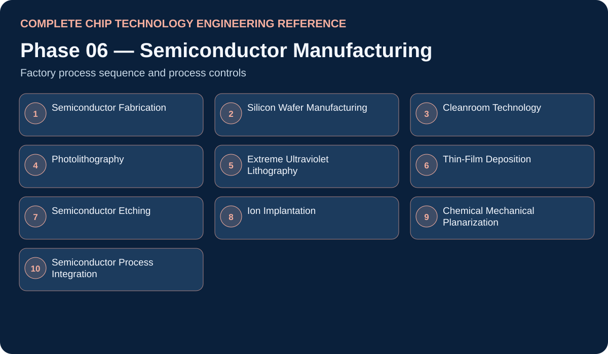

# Phase 06 — Semiconductor Manufacturing

**Scope:** Factory process sequence and process controls. **Topics:** 10. These are compact reference briefs, not completed practical projects.

| # | Engineering subject | Practical checkpoint |
|---|---|---|
| 051 | [Semiconductor Fabrication](topic-051-semiconductor-fabrication/README.md) | Identify inspection checkpoints |
| 052 | [Silicon Wafer Manufacturing](topic-052-silicon-wafer-manufacturing/README.md) | List wafer quality metrics |
| 053 | [Cleanroom Technology](topic-053-cleanroom-technology/README.md) | Identify particle sources |
| 054 | [Photolithography](topic-054-photolithography/README.md) | Identify alignment requirements |
| 055 | [Extreme Ultraviolet Lithography](topic-055-extreme-ultraviolet-lithography/README.md) | Explain why reflective optics are used |
| 056 | [Thin-Film Deposition](topic-056-thin-film-deposition/README.md) | Differentiate coverage goals |
| 057 | [Semiconductor Etching](topic-057-semiconductor-etching/README.md) | Name anisotropy and selectivity |
| 058 | [Ion Implantation](topic-058-ion-implantation/README.md) | Label dose and depth conceptually |
| 059 | [Chemical Mechanical Planarization](topic-059-chemical-mechanical-planarization/README.md) | Identify planarization need |
| 060 | [Semiconductor Process Integration](topic-060-semiconductor-process-integration/README.md) | Check sequence dependencies |

**Publishing rule:** Add code, screenshots, diagrams and measured outcomes only when a real study or build has been performed. Existing 180-day curriculum is independent of this reference library.

[← Master phase index](../README.md)
