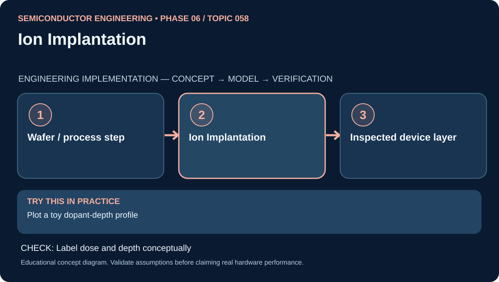

# 058. Ion Implantation

> **Phase 06 — Semiconductor Manufacturing** · Practical visual reference · **Status: reference / not implemented**

## What it does

Factory process sequence and process controls. This topic concerns **ion implantation** and its role in designing, studying, testing or manufacturing chips.

## Practical viewpoint

**Try:** Plot a toy dopant-depth profile.

**Verify:** Label dose and depth conceptually.

## Engineering flow

1. **Input:** Wafer / process step.
2. **Work:** Conceptual fab sequence; apply the method described in the exercise.
3. **Output:** Inspected device layer; document the check and its assumptions.

**Lab boundary:** Semiconductor fabrication uses specialized facilities, hazardous processes and trained personnel. This guide covers conceptual diagrams and safe simulations only.

**Evidence to upload later:** diagram, implementation or simulation, test results, and a short note on what was learned. This reference does not claim any work is finished.

[← Phase overview](../README.md) · [All phases](../../README.md)
