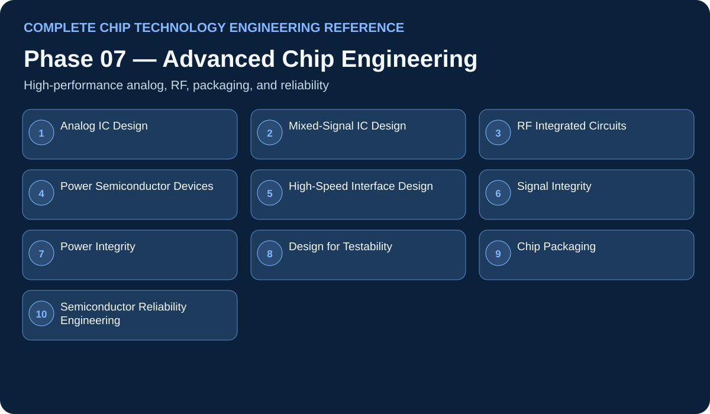

# Phase 07 — Advanced Chip Engineering

**Scope:** High-performance analog, RF, packaging, and reliability. **Topics:** 10. These are compact reference briefs, not completed practical projects.

| # | Engineering subject | Practical checkpoint |
|---|---|---|
| 061 | [Analog IC Design](topic-061-analog-ic-design/README.md) | Calculate closed-loop gain |
| 062 | [Mixed-Signal IC Design](topic-062-mixed-signal-ic-design/README.md) | Identify analog/digital boundary |
| 063 | [RF Integrated Circuits](topic-063-rf-integrated-circuits/README.md) | Label frequency conversion blocks |
| 064 | [Power Semiconductor Devices](topic-064-power-semiconductor-devices/README.md) | State voltage/current assumptions |
| 065 | [High-Speed Interface Design](topic-065-high-speed-interface-design/README.md) | Identify signal timing budget |
| 066 | [Signal Integrity](topic-066-signal-integrity/README.md) | Label rise time and impedance effects |
| 067 | [Power Integrity](topic-067-power-integrity/README.md) | Estimate voltage sag |
| 068 | [Design for Testability](topic-068-design-for-testability/README.md) | Check test observability |
| 069 | [Chip Packaging](topic-069-chip-packaging/README.md) | Label thermal path |
| 070 | [Semiconductor Reliability Engineering](topic-070-semiconductor-reliability-engineering/README.md) | Separate stress from lifetime inference |

**Publishing rule:** Add code, screenshots, diagrams and measured outcomes only when a real study or build has been performed. Existing 180-day curriculum is independent of this reference library.

[← Master phase index](../README.md)
