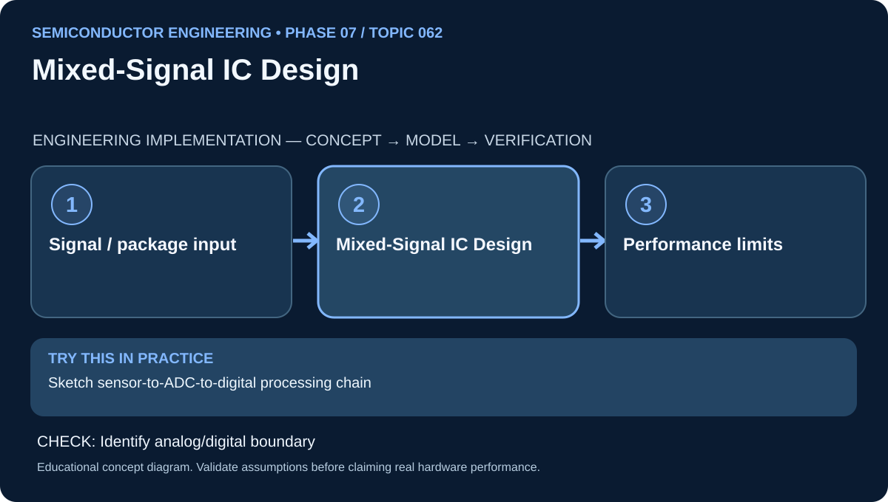

# 062. Mixed-Signal IC Design

> **Phase 07 — Advanced Chip Engineering** · Practical visual reference · **Status: reference / not implemented**

## What it does

High-performance analog, RF, packaging, and reliability. This topic concerns **mixed-signal ic design** and its role in designing, studying, testing or manufacturing chips.

## Practical viewpoint

**Try:** Sketch sensor-to-ADC-to-digital processing chain.

**Verify:** Identify analog/digital boundary.

## Engineering flow

1. **Input:** Signal / package input.
2. **Work:** Advanced circuit analysis; apply the method described in the exercise.
3. **Output:** Performance limits; document the check and its assumptions.

**Evidence to upload later:** diagram, implementation or simulation, test results, and a short note on what was learned. This reference does not claim any work is finished.

[← Phase overview](../README.md) · [All phases](../../README.md)
