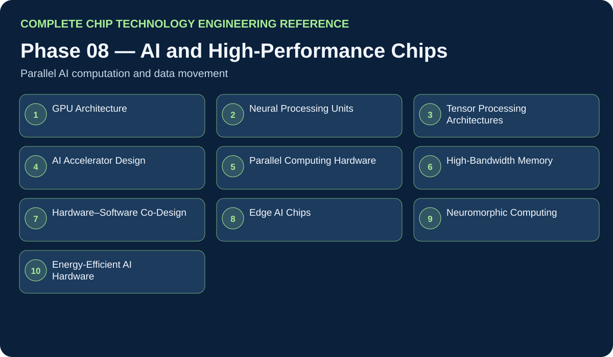

# Phase 08 — AI and High-Performance Chips

**Scope:** Parallel AI computation and data movement. **Topics:** 10. These are compact reference briefs, not completed practical projects.

| # | Engineering subject | Practical checkpoint |
|---|---|---|
| 071 | [GPU Architecture](topic-071-gpu-architecture/README.md) | Compare parallel workloads |
| 072 | [Neural Processing Units](topic-072-neural-processing-units/README.md) | Count MAC operations |
| 073 | [Tensor Processing Architectures](topic-073-tensor-processing-architectures/README.md) | Estimate data reuse |
| 074 | [AI Accelerator Design](topic-074-ai-accelerator-design/README.md) | Check numeric correctness |
| 075 | [Parallel Computing Hardware](topic-075-parallel-computing-hardware/README.md) | Estimate ideal speedup |
| 076 | [High-Bandwidth Memory](topic-076-high-bandwidth-memory/README.md) | Estimate bandwidth from width and rate |
| 077 | [Hardware–Software Co-Design](topic-077-hardware-software-co-design/README.md) | Compare data movement |
| 078 | [Edge AI Chips](topic-078-edge-ai-chips/README.md) | Measure output error |
| 079 | [Neuromorphic Computing](topic-079-neuromorphic-computing/README.md) | Plot spike timing |
| 080 | [Energy-Efficient AI Hardware](topic-080-energy-efficient-ai-hardware/README.md) | Estimate arithmetic intensity |

**Publishing rule:** Add code, screenshots, diagrams and measured outcomes only when a real study or build has been performed. Existing 180-day curriculum is independent of this reference library.

[← Master phase index](../README.md)
