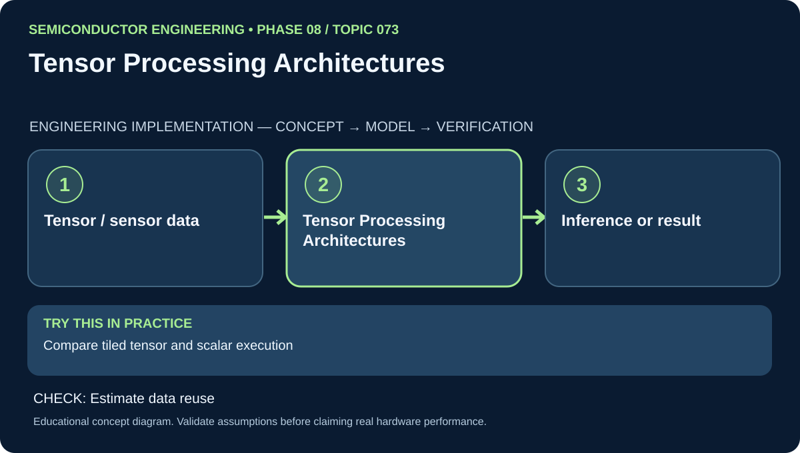

# 073. Tensor Processing Architectures

> **Phase 08 — AI and High-Performance Chips** · Practical visual reference · **Status: reference / not implemented**

## What it does

Parallel AI computation and data movement. This topic concerns **tensor processing architectures** and its role in designing, studying, testing or manufacturing chips.

## Practical viewpoint

**Try:** Compare tiled tensor and scalar execution.

**Verify:** Estimate data reuse.

## Engineering flow

1. **Input:** Tensor / sensor data.
2. **Work:** Specialized accelerator; apply the method described in the exercise.
3. **Output:** Inference or result; document the check and its assumptions.

**Evidence to upload later:** diagram, implementation or simulation, test results, and a short note on what was learned. This reference does not claim any work is finished.

[← Phase overview](../README.md) · [All phases](../../README.md)
