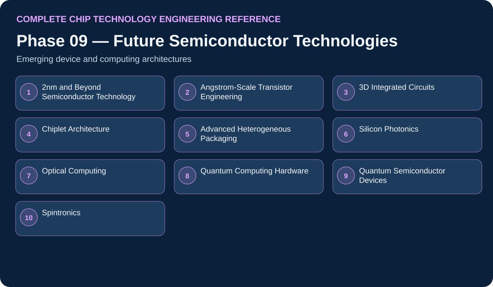

# Phase 09 — Future Semiconductor Technologies

**Scope:** Emerging device and computing architectures. **Topics:** 10. These are compact reference briefs, not completed practical projects.

| # | Engineering subject | Practical checkpoint |
|---|---|---|
| 081 | [2nm and Beyond Semiconductor Technology](topic-081-2nm-and-beyond-semiconductor-technology/README.md) | Explain node naming caveat |
| 082 | [Angstrom-Scale Transistor Engineering](topic-082-angstrom-scale-transistor-engineering/README.md) | Identify power and variability limits |
| 083 | [3D Integrated Circuits](topic-083-3d-integrated-circuits/README.md) | Label thermal challenges |
| 084 | [Chiplet Architecture](topic-084-chiplet-architecture/README.md) | Define die-to-die interfaces |
| 085 | [Advanced Heterogeneous Packaging](topic-085-advanced-heterogeneous-packaging/README.md) | Identify integration tradeoffs |
| 086 | [Silicon Photonics](topic-086-silicon-photonics/README.md) | Mark optical/electrical boundaries |
| 087 | [Optical Computing](topic-087-optical-computing/README.md) | List practical limitations |
| 088 | [Quantum Computing Hardware](topic-088-quantum-computing-hardware/README.md) | Distinguish classical and quantum circuits |
| 089 | [Quantum Semiconductor Devices](topic-089-quantum-semiconductor-devices/README.md) | Identify confinement and control |
| 090 | [Spintronics](topic-090-spintronics/README.md) | Describe read/write abstraction |

**Publishing rule:** Add code, screenshots, diagrams and measured outcomes only when a real study or build has been performed. Existing 180-day curriculum is independent of this reference library.

[← Master phase index](../README.md)
