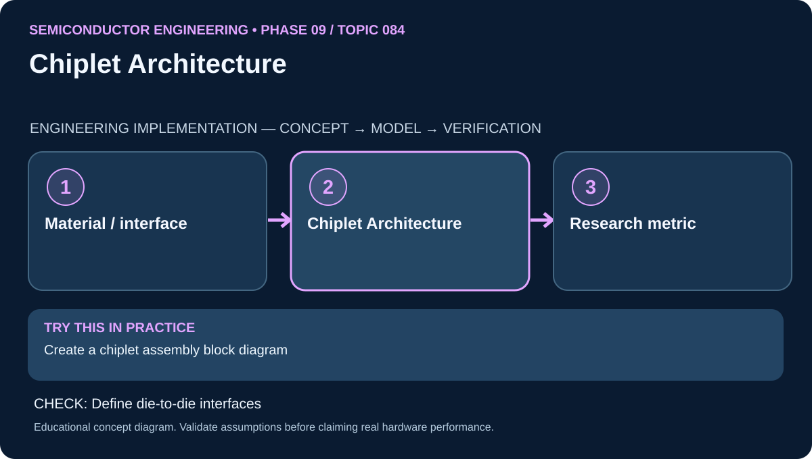

# 084. Chiplet Architecture

> **Phase 09 — Future Semiconductor Technologies** · Practical visual reference · **Status: reference / not implemented**

## What it does

Emerging device and computing architectures. This topic concerns **chiplet architecture** and its role in designing, studying, testing or manufacturing chips.

## Practical viewpoint

**Try:** Create a chiplet assembly block diagram.

**Verify:** Define die-to-die interfaces.

## Engineering flow

1. **Input:** Material / interface.
2. **Work:** Emerging device concept; apply the method described in the exercise.
3. **Output:** Research metric; document the check and its assumptions.

**Evidence to upload later:** diagram, implementation or simulation, test results, and a short note on what was learned. This reference does not claim any work is finished.

[← Phase overview](../README.md) · [All phases](../../README.md)
