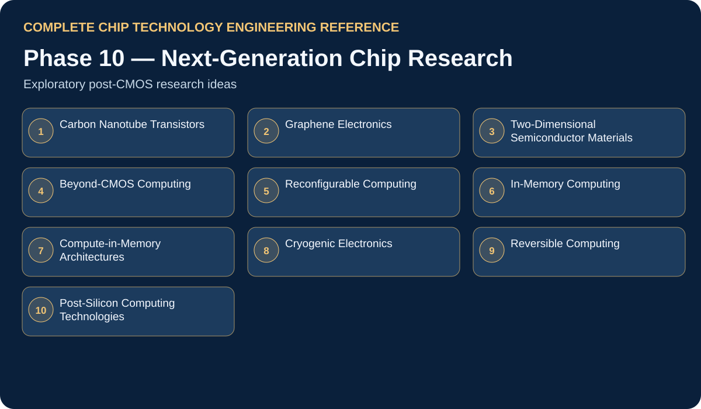

# Phase 10 — Next-Generation Chip Research

**Scope:** Exploratory post-CMOS research ideas. **Topics:** 10. These are compact reference briefs, not completed practical projects.

| # | Engineering subject | Practical checkpoint |
|---|---|---|
| 091 | [Carbon Nanotube Transistors](topic-091-carbon-nanotube-transistors/README.md) | Identify placement and contact challenges |
| 092 | [Graphene Electronics](topic-092-graphene-electronics/README.md) | Explain switching obstacle |
| 093 | [Two-Dimensional Semiconductor Materials](topic-093-two-dimensional-semiconductor-materials/README.md) | List material and interface issues |
| 094 | [Beyond-CMOS Computing](topic-094-beyond-cmos-computing/README.md) | Separate maturity from promise |
| 095 | [Reconfigurable Computing](topic-095-reconfigurable-computing/README.md) | Change the programmed logic |
| 096 | [In-Memory Computing](topic-096-in-memory-computing/README.md) | Estimate reduced data transfers |
| 097 | [Compute-in-Memory Architectures](topic-097-compute-in-memory-architectures/README.md) | Identify precision limits |
| 098 | [Cryogenic Electronics](topic-098-cryogenic-electronics/README.md) | Identify heat-load constraint |
| 099 | [Reversible Computing](topic-099-reversible-computing/README.md) | Verify bijection |
| 100 | [Post-Silicon Computing Technologies](topic-100-post-silicon-computing-technologies/README.md) | Identify evidence gaps |

**Publishing rule:** Add code, screenshots, diagrams and measured outcomes only when a real study or build has been performed. Existing 180-day curriculum is independent of this reference library.

[← Master phase index](../README.md)
