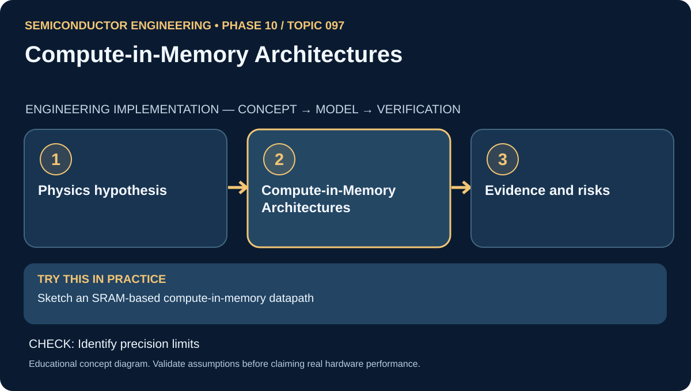

# 097. Compute-in-Memory Architectures

> **Phase 10 — Next-Generation Chip Research** · Practical visual reference · **Status: reference / not implemented**

## What it does

Exploratory post-CMOS research ideas. This topic concerns **compute-in-memory architectures** and its role in designing, studying, testing or manufacturing chips.

## Practical viewpoint

**Try:** Sketch an SRAM-based compute-in-memory datapath.

**Verify:** Identify precision limits.

## Engineering flow

1. **Input:** Physics hypothesis.
2. **Work:** Experimental abstraction; apply the method described in the exercise.
3. **Output:** Evidence and risks; document the check and its assumptions.

**Evidence to upload later:** diagram, implementation or simulation, test results, and a short note on what was learned. This reference does not claim any work is finished.

[← Phase overview](../README.md) · [All phases](../../README.md)
