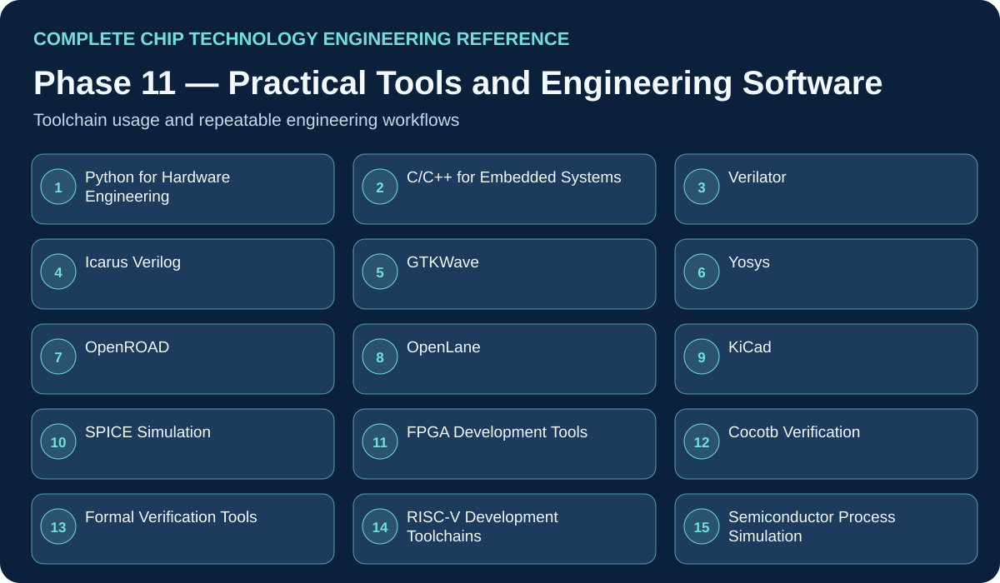

# Phase 11 — Practical Tools and Engineering Software

**Scope:** Toolchain usage and repeatable engineering workflows. **Topics:** 15. These are compact reference briefs, not completed practical projects.

| # | Engineering subject | Practical checkpoint |
|---|---|---|
| 101 | [Python for Hardware Engineering](topic-101-python-for-hardware-engineering/README.md) | Test exhaustive input space |
| 102 | [C/C++ for Embedded Systems](topic-102-c-c-for-embedded-systems/README.md) | Check defined integer types |
| 103 | [Verilator](topic-103-verilator/README.md) | Name compiler and test outputs |
| 104 | [Icarus Verilog](topic-104-icarus-verilog/README.md) | Inspect simulation log |
| 105 | [GTKWave](topic-105-gtkwave/README.md) | Identify expected transitions |
| 106 | [Yosys](topic-106-yosys/README.md) | Record cell statistics |
| 107 | [OpenROAD](topic-107-openroad/README.md) | Track timing reports |
| 108 | [OpenLane](topic-108-openlane/README.md) | Identify process design kit dependency |
| 109 | [KiCad](topic-109-kicad/README.md) | Run electrical rules check |
| 110 | [SPICE Simulation](topic-110-spice-simulation/README.md) | Compare theoretical voltages |
| 111 | [FPGA Development Tools](topic-111-fpga-development-tools/README.md) | Separate device-specific steps |
| 112 | [Cocotb Verification](topic-112-cocotb-verification/README.md) | Check simulator-driven outputs |
| 113 | [Formal Verification Tools](topic-113-formal-verification-tools/README.md) | Clarify proof assumptions |
| 114 | [RISC-V Development Toolchains](topic-114-risc-v-development-toolchains/README.md) | Identify ISA target settings |
| 115 | [Semiconductor Process Simulation](topic-115-semiconductor-process-simulation/README.md) | List needed process models |

**Publishing rule:** Add code, screenshots, diagrams and measured outcomes only when a real study or build has been performed. Existing 180-day curriculum is independent of this reference library.

[← Master phase index](../README.md)
