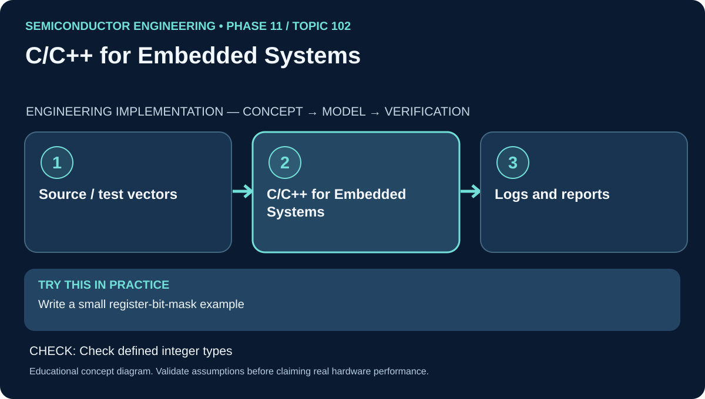

# 102. C/C++ for Embedded Systems

> **Phase 11 — Practical Tools and Engineering Software** · Practical visual reference · **Status: reference / not implemented**

## What it does

Toolchain usage and repeatable engineering workflows. This topic concerns **c/c++ for embedded systems** and its role in designing, studying, testing or manufacturing chips.

## Practical viewpoint

**Try:** Write a small register-bit-mask example.

**Verify:** Check defined integer types.

## Engineering flow

1. **Input:** Source / test vectors.
2. **Work:** Engineering software tool; apply the method described in the exercise.
3. **Output:** Logs and reports; document the check and its assumptions.

**Evidence to upload later:** diagram, implementation or simulation, test results, and a short note on what was learned. This reference does not claim any work is finished.

[← Phase overview](../README.md) · [All phases](../../README.md)
