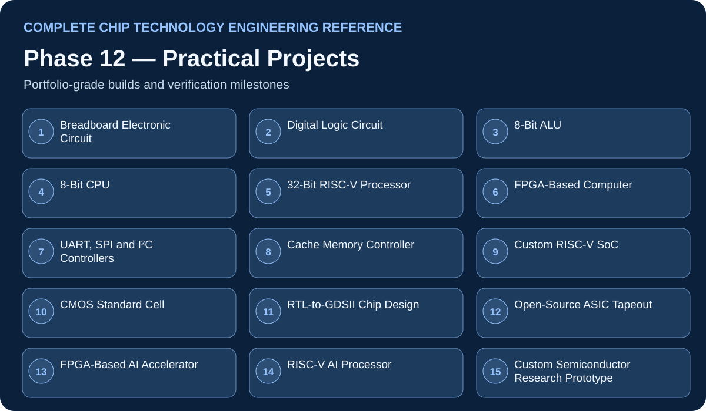

# Phase 12 — Practical Projects

**Scope:** Portfolio-grade builds and verification milestones. **Topics:** 15. These are compact reference briefs, not completed practical projects.

| # | Engineering subject | Practical checkpoint |
|---|---|---|
| 116 | [Breadboard Electronic Circuit](topic-116-breadboard-electronic-circuit/README.md) | Check current before assembly |
| 117 | [Digital Logic Circuit](topic-117-digital-logic-circuit/README.md) | Test all truth tables |
| 118 | [8-Bit ALU](topic-118-8-bit-alu/README.md) | Test carry and overflow |
| 119 | [8-Bit CPU](topic-119-8-bit-cpu/README.md) | Run a short program |
| 120 | [32-Bit RISC-V Processor](topic-120-32-bit-risc-v-processor/README.md) | Check architectural state |
| 121 | [FPGA-Based Computer](topic-121-fpga-based-computer/README.md) | Plan clock and I/O budgets |
| 122 | [UART, SPI and I²C Controllers](topic-122-uart-spi-and-i-c-controllers/README.md) | Check framing and clock conditions |
| 123 | [Cache Memory Controller](topic-123-cache-memory-controller/README.md) | Verify replacement logic |
| 124 | [Custom RISC-V SoC](topic-124-custom-risc-v-soc/README.md) | Verify memory map |
| 125 | [CMOS Standard Cell](topic-125-cmos-standard-cell/README.md) | Identify transistor stack and pins |
| 126 | [RTL-to-GDSII Chip Design](topic-126-rtl-to-gdsii-chip-design/README.md) | Check DRC/LVS dependencies |
| 127 | [Open-Source ASIC Tapeout](topic-127-open-source-asic-tapeout/README.md) | Do not claim fabricated silicon |
| 128 | [FPGA-Based AI Accelerator](topic-128-fpga-based-ai-accelerator/README.md) | Check arithmetic and throughput |
| 129 | [RISC-V AI Processor](topic-129-risc-v-ai-processor/README.md) | Compare software baseline |
| 130 | [Custom Semiconductor Research Prototype](topic-130-custom-semiconductor-research-prototype/README.md) | Report limitations and reproducibility |

**Publishing rule:** Add code, screenshots, diagrams and measured outcomes only when a real study or build has been performed. Existing 180-day curriculum is independent of this reference library.

[← Master phase index](../README.md)
