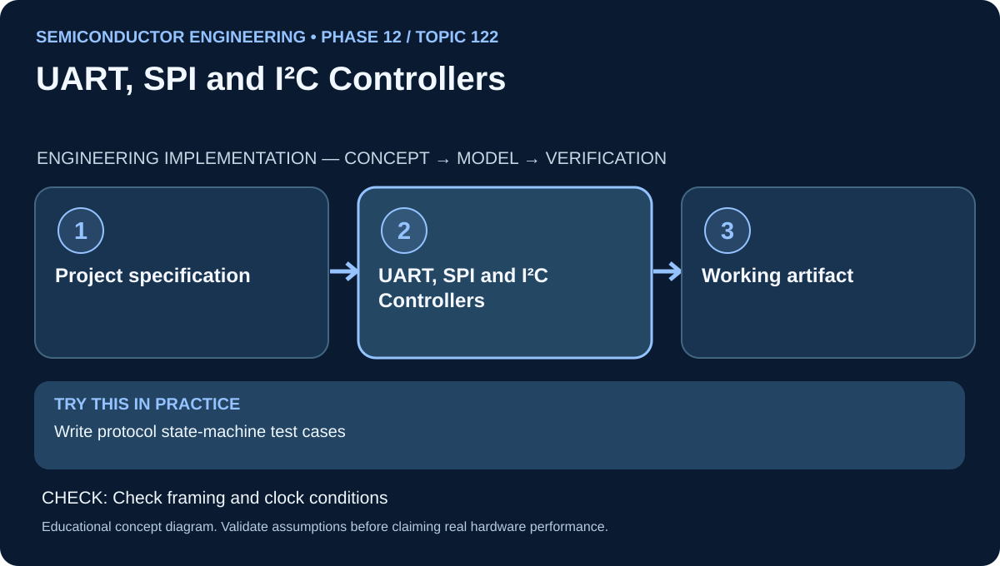

# 122. UART, SPI and I²C Controllers

> **Phase 12 — Practical Projects** · Practical visual reference · **Status: reference / not implemented**

## What it does

Portfolio-grade builds and verification milestones. This topic concerns **uart, spi and i²c controllers** and its role in designing, studying, testing or manufacturing chips.

## Practical viewpoint

**Try:** Write protocol state-machine test cases.

**Verify:** Check framing and clock conditions.

## Engineering flow

1. **Input:** Project specification.
2. **Work:** Build / simulate / test; apply the method described in the exercise.
3. **Output:** Working artifact; document the check and its assumptions.

**Build boundary:** Hardware, FPGA, and tapeout projects require appropriate tools, permissions and safety review. These notes are a design brief, not a claim of a completed build.

**Evidence to upload later:** diagram, implementation or simulation, test results, and a short note on what was learned. This reference does not claim any work is finished.

[← Phase overview](../README.md) · [All phases](../../README.md)
