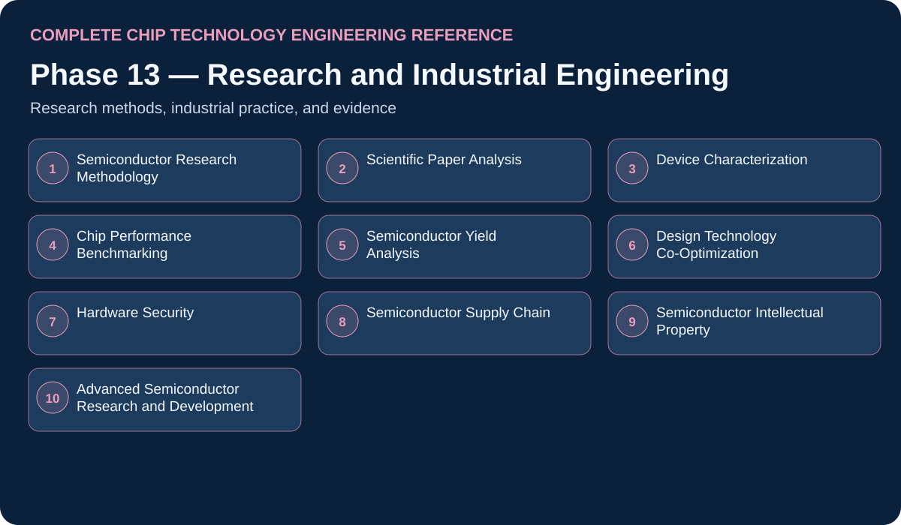

# Phase 13 — Research and Industrial Engineering

**Scope:** Research methods, industrial practice, and evidence. **Topics:** 10. These are compact reference briefs, not completed practical projects.

| # | Engineering subject | Practical checkpoint |
|---|---|---|
| 131 | [Semiconductor Research Methodology](topic-131-semiconductor-research-methodology/README.md) | Create reproducible protocol |
| 132 | [Scientific Paper Analysis](topic-132-scientific-paper-analysis/README.md) | Separate evidence from claims |
| 133 | [Device Characterization](topic-133-device-characterization/README.md) | Identify calibration variables |
| 134 | [Chip Performance Benchmarking](topic-134-chip-performance-benchmarking/README.md) | Ensure workload parity |
| 135 | [Semiconductor Yield Analysis](topic-135-semiconductor-yield-analysis/README.md) | State independence assumptions |
| 136 | [Design Technology Co-Optimization](topic-136-design-technology-co-optimization/README.md) | Record PPA tradeoffs |
| 137 | [Hardware Security](topic-137-hardware-security/README.md) | Check failure behavior |
| 138 | [Semiconductor Supply Chain](topic-138-semiconductor-supply-chain/README.md) | Identify bottlenecks |
| 139 | [Semiconductor Intellectual Property](topic-139-semiconductor-intellectual-property/README.md) | Record provenance |
| 140 | [Advanced Semiconductor Research and Development](topic-140-advanced-semiconductor-research-and-development/README.md) | Define measurable gates and risks |

**Publishing rule:** Add code, screenshots, diagrams and measured outcomes only when a real study or build has been performed. Existing 180-day curriculum is independent of this reference library.

[← Master phase index](../README.md)
