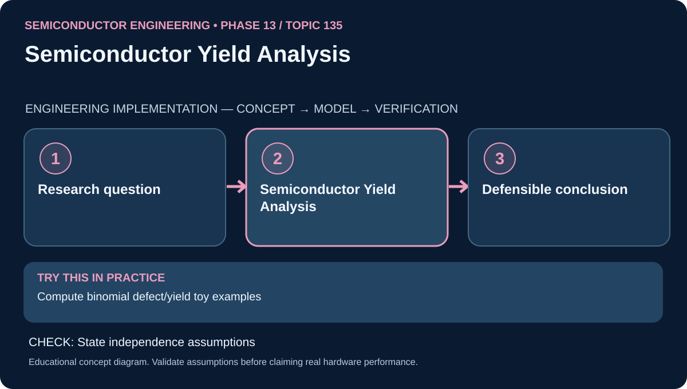

# 135. Semiconductor Yield Analysis

> **Phase 13 — Research and Industrial Engineering** · Practical visual reference · **Status: reference / not implemented**

## What it does

Research methods, industrial practice, and evidence. This topic concerns **semiconductor yield analysis** and its role in designing, studying, testing or manufacturing chips.

## Practical viewpoint

**Try:** Compute binomial defect/yield toy examples.

**Verify:** State independence assumptions.

## Engineering flow

1. **Input:** Research question.
2. **Work:** Measurement and analysis; apply the method described in the exercise.
3. **Output:** Defensible conclusion; document the check and its assumptions.

**Evidence to upload later:** diagram, implementation or simulation, test results, and a short note on what was learned. This reference does not claim any work is finished.

[← Phase overview](../README.md) · [All phases](../../README.md)
