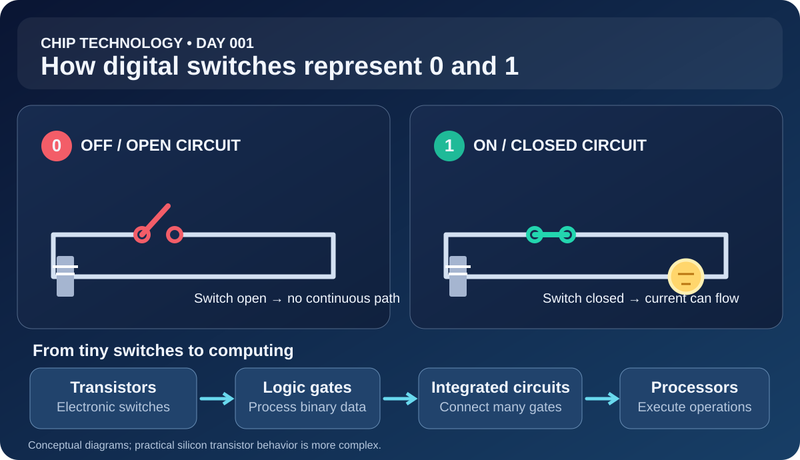

# Day 001 - Visual Lesson

# Day 001 — What Is a Computer Chip?

## What I Learned

A semiconductor chip is an integrated circuit containing
electronic components, including transistors.

Transistors can be used as electronic switches.

Digital circuits use two logical states:
- 0: LOW
- 1: HIGH

Real transistor behavior is more complex than a simple switch.

## Today's Practical Exercise

I created a Python program that models a digital switch.

Input 0 produces OFF.
Input 1 produces ON.

## Result

The program runs and demonstrates a basic binary switching concept.

## Next Lesson

Day 002 — Electricity, Voltage, Current, and Resistance.
