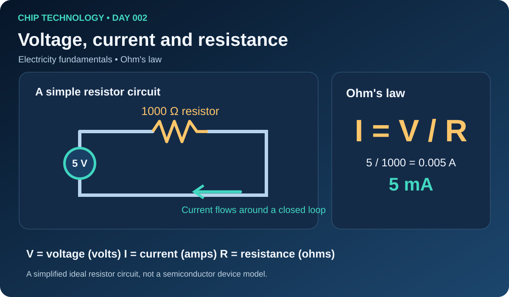

# Day 002 - Electricity Fundamentals

## Learning Objectives

Understand voltage, current, resistance, and Ohm's law.

## Key Concepts

Voltage (V): Electric potential difference, measured in volts.
Current (I): Rate of electric charge flow, measured in amperes.
Resistance (R): Opposition to current, measured in ohms.

## Ohm's Law

V = I * R

I = V / R

R = V / I

## Worked Example

Voltage = 5 V
Resistance = 1000 ohms
Current = 5 / 1000 = 0.005 A = 5 mA

## Semiconductor Relevance

Transistors control electrical current. Digital chips
combine large numbers of transistors to process information.

## Practical Exercise

Implement an Ohm's law calculator using Python.
