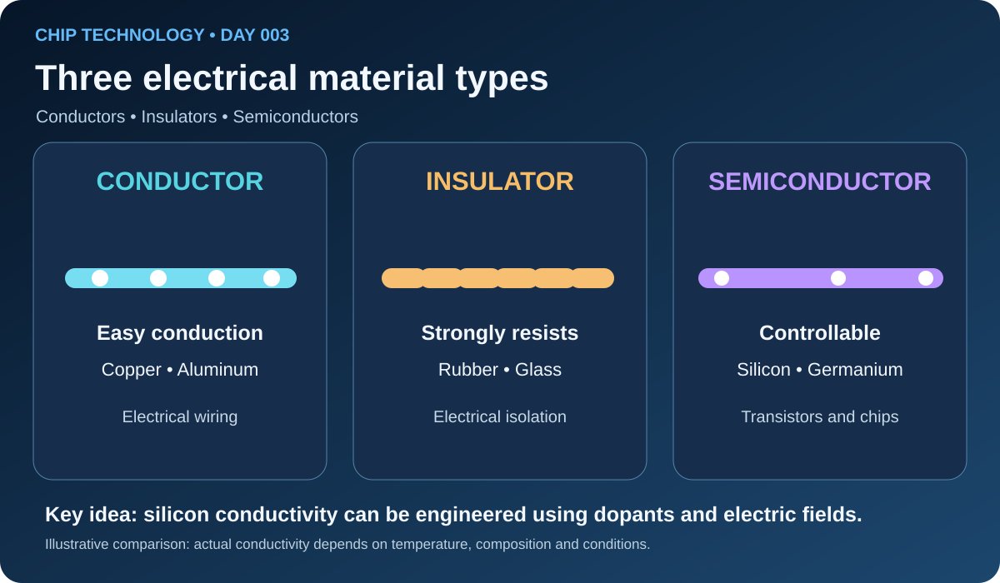

# Day 003 - Conductors, Insulators, and Semiconductors

## Learning Objective

Understand how different materials behave electrically
and why silicon is widely used in computer chips.

## Conductors

Conductors allow electrical current to flow relatively easily.

Examples:
- Copper
- Aluminum
- Silver

Applications:
- Wires
- Electrical connections

## Insulators

Insulators strongly resist electrical current under
ordinary operating conditions.

Examples:
- Rubber
- Glass
- Plastic

Applications:
- Cable insulation
- Electrical isolation

## Semiconductors

Semiconductors have electrical properties that engineers
can control using doping, electric fields, and temperature.

Examples:
- Silicon
- Germanium
- Gallium arsenide

Applications:
- Transistors
- Computer chips
- Sensors

## Important Concept

Silicon is useful because it can be engineered to
control electrical conduction.

## Today's Practical

Create a Python material classification program.

Note: This is a simplified educational classification,
not a physical semiconductor simulation.
