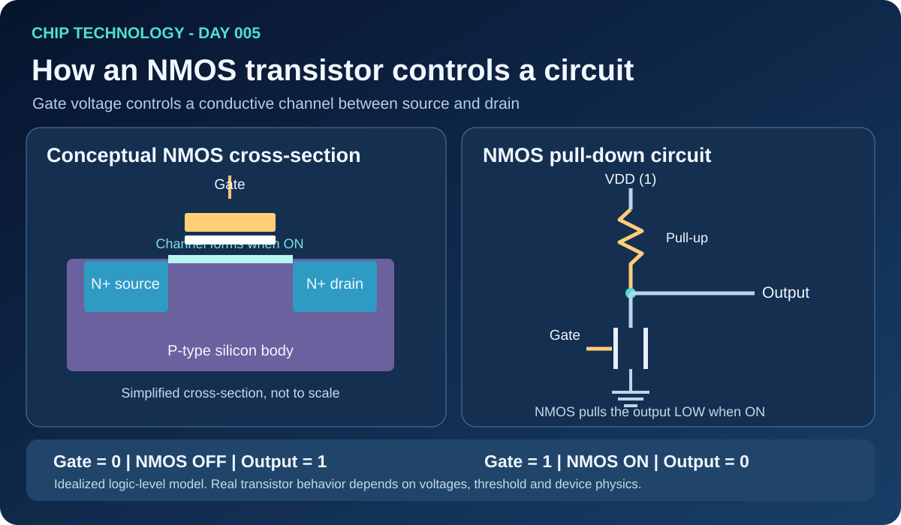

# Day 005 - Transistor Fundamentals

## Learning Objectives

- Recognize the gate, source, and drain terminals of a MOSFET.
- Explain how an enhancement-mode N-channel MOSFET can operate as a switch.
- Understand a simplified NMOS pull-down circuit and its output logic.

## What Is a Transistor?

A transistor is a semiconductor device that controls electrical current.
MOSFETs are important building blocks of integrated circuits.

## Three MOSFET Terminals

- **Gate:** Electric field controls the formation of a channel.
- **Source:** One end of the conducting channel.
- **Drain:** The other end of the conducting channel.

A real MOSFET also has a body or substrate terminal.

## Simplified NMOS Pull-Down Circuit

Our idealized circuit has an NMOS transistor between the output and ground.
A pull-up resistor connects the output to the positive supply.

| Gate input | NMOS | Output |
| --- | --- | --- |
| 0 | OFF | 1 (HIGH) |
| 1 | ON | 0 (LOW) |

The gate signal and circuit output are different quantities.
This particular circuit inverts its input.

## Why It Matters

Transistors implement digital logic. Later lessons combine NMOS and PMOS
transistors into CMOS logic gates, which are widely used in processors.

## Practical

Run `python3 practical.py` to model this idealized pull-down circuit.

**Limitations:** This is a binary educational model, not a transistor physics,
timing, leakage, or SPICE simulation.
