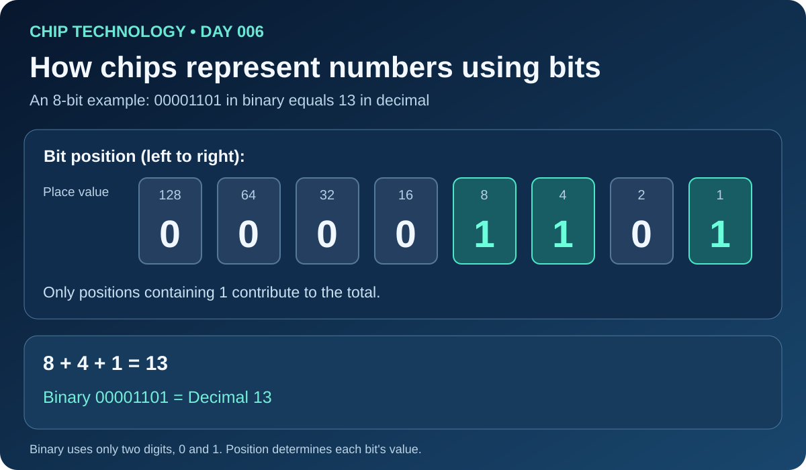

# Day 006 — Binary Numbers and Data Representation

## Learning Objectives

- Understand bits and bytes.
- Convert small positive integers between decimal and binary.
- Read binary place values.
- Recognize why digital hardware uses two logic levels.

## Bits and Bytes

A **bit** is a binary digit: 0 or 1. A **byte** contains 8 bits.
Digital circuits implement logic values using voltage ranges.

## Binary Place Values

From right to left, binary positions have values:

`1, 2, 4, 8, 16, 32, 64, 128, ...`

For example, `00001101` has 1s in the 8, 4, and 1 positions:

`8 + 4 + 1 = 13` (decimal).

## Decimal to Binary

Repeatedly divide the positive integer by two and collect remainders.
Read the remainders in reverse order.

Alternatively, Python provides `bin(13)`, which returns `0b1101`.

## Why This Matters for Chips

Digital hardware stores and processes data as combinations of bits.
Later lessons will build logic gates, adders, registers and memory.

## Practical Exercise

Run `python3 practical.py` and inspect the conversion table.

> This is a software exercise about binary representation, not a transistor-level simulation.
