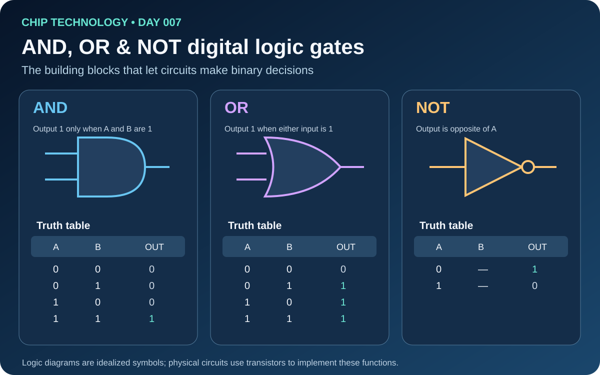

# Day 007 — Digital Logic Gates

## Learning Objectives

- Explain the AND, OR, and NOT operations.
- Read and construct truth tables.
- Connect transistor-based switching to digital logic.
- Implement idealized gates using Python.

## AND Gate

AND produces output 1 **only if both inputs are 1**.

| A | B | A AND B |
|---|---|---|
| 0 | 0 | 0 |
| 0 | 1 | 0 |
| 1 | 0 | 0 |
| 1 | 1 | 1 |

## OR Gate

OR produces output 1 **if at least one input is 1**.

| A | B | A OR B |
|---|---|---|
| 0 | 0 | 0 |
| 0 | 1 | 1 |
| 1 | 0 | 1 |
| 1 | 1 | 1 |

## NOT Gate

NOT is a one-input gate and inverts its input.

| A | NOT A |
|---|---|
| 0 | 1 |
| 1 | 0 |

## Connection to Chip Engineering

Combinations of transistor switches implement logic gates.
Logic gates form the basis of arithmetic, registers, state machines,
and computer processors.

## Practical

Run `python3 practical.py` to generate truth tables and run assertions.

This is a functional logic model, not a transistor physics simulation.
