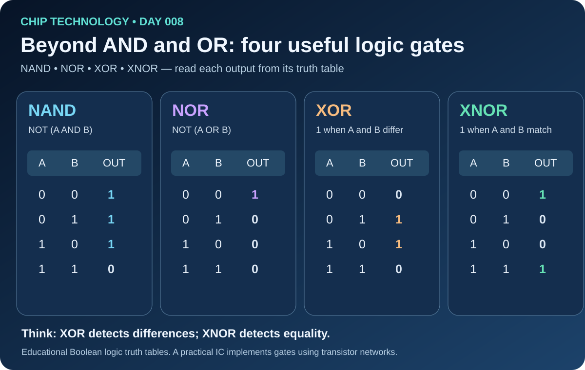

# Day 008 — NAND, NOR, XOR and XNOR Logic Gates

## Learning Objectives

- Understand NAND, NOR, XOR and XNOR.
- Predict each gate's output for all binary input pairs.
- Test logic-gate implementations with Python.
- Explain how XOR is useful in arithmetic circuits.

## Definitions

- **NAND:** NOT(AND). It outputs 0 only when both inputs are 1.
- **NOR:** NOT(OR). It outputs 1 only when both inputs are 0.
- **XOR:** Outputs 1 when its two inputs differ.
- **XNOR:** Outputs 1 when its two inputs are equal.

## Truth Tables

| A | B | NAND | NOR | XOR | XNOR |
|---|---|------|-----|-----|------|
| 0 | 0 | 1 | 1 | 0 | 1 |
| 0 | 1 | 1 | 0 | 1 | 0 |
| 1 | 0 | 1 | 0 | 1 | 0 |
| 1 | 1 | 0 | 0 | 0 | 1 |

## Why They Matter

NAND and NOR are **universal gates**: either type can be used to
construct any Boolean logic function. XOR helps compute the sum bit
of a binary half adder.

## Practical Exercise

Run `python3 practical.py` and compare the output with the table.

This exercise models logical behavior rather than electrical characteristics.
