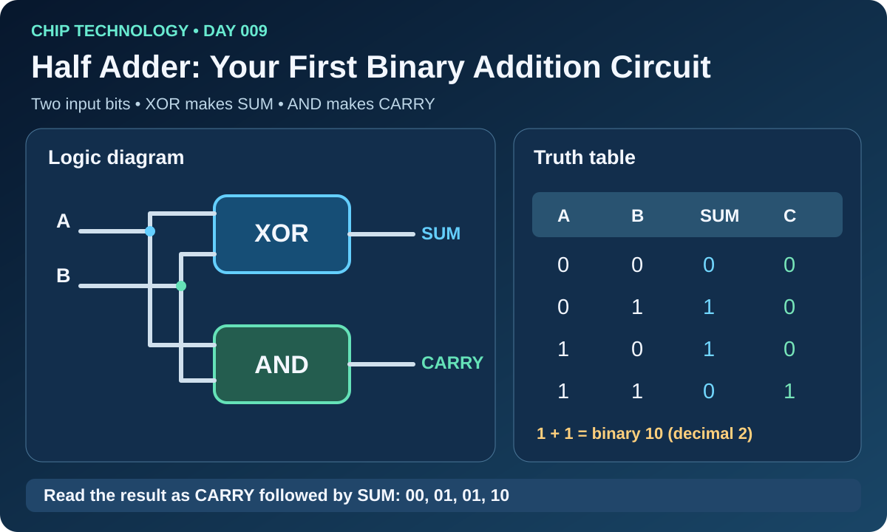

# Day 009 — Half Adder: Your First Binary Addition Circuit

## Learning Objectives

- Understand how XOR and AND gates add two single bits.
- Distinguish **SUM** from **CARRY**.
- Read a half-adder truth table.
- Write and test a half-adder program.

## How a Half Adder Works

Two one-bit inputs, A and B, feed two gates in parallel:

- SUM = A XOR B
- CARRY = A AND B

Read the output as a two-bit binary number: **CARRY SUM**.

## Truth Table

| A | B | SUM (XOR) | CARRY (AND) | Two-bit result |
|---|---|-----------|-------------|----------------|
| 0 | 0 | 0 | 0 | 00 |
| 0 | 1 | 1 | 0 | 01 |
| 1 | 0 | 1 | 0 | 01 |
| 1 | 1 | 0 | 1 | 10 |

Example: `1 + 1 = 10` in binary, equal to 2 in decimal.

## Why It Matters

A half adder shows how logic gates implement arithmetic.
It cannot accept a carry-in from an earlier stage.
A **full adder**, covered next, adds A, B, and carry-in.

## Practical

Run `python3 practical.py` and verify the output truth table.

This is a Boolean logic model, not a physical chip simulation.
