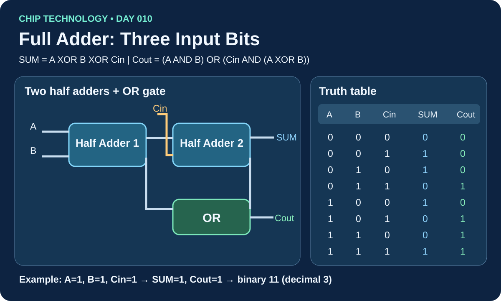

# Day 010 — Full Adder and Carry-In

## Learning Objectives

- Understand the three inputs A, B and Cin (carry-in).
- Build a full adder from two half adders and an OR gate.
- Calculate SUM and Cout (carry-out).
- Understand how carry propagates between bit positions.

## Full Adder versus Half Adder

A half adder adds **A + B** only.
A full adder adds **A + B + Cin**.

## Build the Circuit

1. Half Adder 1 combines A and B to produce intermediate SUM1 and CARRY1.
2. Half Adder 2 combines SUM1 and Cin to produce SUM and CARRY2.
3. OR combines CARRY1 and CARRY2 into Cout.

## Equations

- `SUM = A XOR B XOR Cin`
- `Cout = (A AND B) OR (Cin AND (A XOR B))`

## Truth Table

| A | B | Cin | SUM | Cout |
|---|---|-----|-----|------|
| 0 | 0 | 0 | 0 | 0 |
| 0 | 0 | 1 | 1 | 0 |
| 0 | 1 | 0 | 1 | 0 |
| 0 | 1 | 1 | 0 | 1 |
| 1 | 0 | 0 | 1 | 0 |
| 1 | 0 | 1 | 0 | 1 |
| 1 | 1 | 0 | 0 | 1 |
| 1 | 1 | 1 | 1 | 1 |

**Example:** 1 + 1 + 1 = binary `11` (decimal 3).

## Why Full Adders Matter

Connect the Cout of one full-adder stage to the Cin of the
next higher bit stage to create a multi-bit ripple-carry adder.

## Practical

Run `python3 practical.py`.
This is a Boolean model, not a physical transistor simulation.
