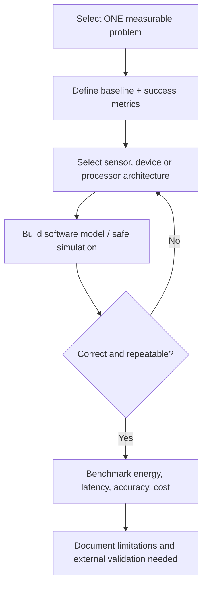

# 100 Real-World Problems Semiconductor Technology Can Help Address

**Visual problem–technology–solution catalogue | Research reference | Updated November 2026**

> **Scope:** Chips enable sensors, computation, communication, protection and control. Their impact depends on the full system, sound deployment, economics, and appropriate validation. These are 100 opportunities and existing applications—not claims that 100 problems are already completely solved.

## How semiconductor solutions work

## Quick navigation

- [01. Healthcare and Human Health](#1-healthcare-and-human-health)
- [02. Energy, Electricity and Climate](#2-energy-electricity-and-climate)
- [03. Water, Agriculture and Food Security](#3-water-agriculture-and-food-security)
- [04. Transport and Mobility](#4-transport-and-mobility)
- [05. Cities, Buildings and Infrastructure](#5-cities-buildings-and-infrastructure)
- [06. Disasters and Environmental Monitoring](#6-disasters-and-environmental-monitoring)
- [07. Education, Communications and Accessibility](#7-education-communications-and-accessibility)
- [08. Cybersecurity, Privacy and Digital Trust](#8-cybersecurity-privacy-and-digital-trust)
- [09. Industry, Manufacturing and Science](#9-industry-manufacturing-and-science)
- [10. Future Computing and Research](#10-future-computing-and-research)

## 1. Healthcare and Human Health

| # | Real-world problem | Chip technology | Practical value |
|---:|---|---|---|
| 1 | Late heart-abnormality detection | ECG sensing + signal-processing IC | Earlier identification of patterns for clinical review |
| 2 | Limited local diagnostic access | Lab-on-chip sensors + embedded processing | Portable testing support |
| 3 | Hard-to-monitor chronic conditions | Ultra-low-power wearable biosensor chips | Longer-duration remote monitoring |
| 4 | Slow medical-image processing | Image detectors + accelerated reconstruction | Faster processing of diagnostic images |
| 5 | Insulin delivery monitoring | Glucose sensors + pump-control ICs | Continuous monitoring and controlled delivery |
| 6 | Hearing impairment | Digital signal-processing hearing aids | Improved audio processing |
| 7 | Visual impairment | Vision sensors + assistive processors | Scene descriptions and navigation aids |
| 8 | Movement-disorder treatment needs | Implantable stimulation-control electronics | Controlled neuromodulation in approved uses |
| 9 | Slow laboratory testing workflows | Semiconductor sensing + instrument automation | Reduced manual processing time |
| 10 | Remote patient monitoring gaps | Secure connected medical-monitoring chips | More frequent measurements outside clinics |

**Practical starting experiment:** Simulate biosignal filtering and compare accuracy, false alerts, and power needs. Clinical deployment requires professional validation.

## 2. Energy, Electricity and Climate

| # | Real-world problem | Chip technology | Practical value |
|---:|---|---|---|
| 11 | Energy lost during power conversion | SiC/GaN switching devices | Lower converter losses in suitable designs |
| 12 | High data-centre electricity demand | Efficient GPUs/NPUs + optimized memory | Less energy per supported computation |
| 13 | Solar energy conversion losses | Power inverters + MPPT controllers | More efficient energy extraction and conversion |
| 14 | Wind-turbine power control | Power conversion ICs | More controllable renewable output |
| 15 | Battery overcharge and damage | Battery management ICs | Voltage, temperature and charge protection |
| 16 | Power-grid equipment failures | Monitoring and protective-control ICs | Faster fault detection and response |
| 17 | Appliance standby and operating losses | Power-management chips | Lower wasted energy |
| 18 | Industrial motor inefficiency | Motor-drive semiconductor controllers | Improved speed and power control |
| 19 | Poor visibility into electricity use | Smart-meter measurement ICs | Detailed consumption measurements |
| 20 | Unstable renewable-grid integration | Power-electronics control and sensing | Improved converter behavior and grid support |

**Practical starting experiment:** Compare optimized arithmetic or power-control models against a defined baseline; record efficiency and performance assumptions.

## 3. Water, Agriculture and Food Security

| # | Real-world problem | Chip technology | Practical value |
|---:|---|---|---|
| 21 | Water wasted by over-irrigation | Soil sensors + microcontrollers | Condition-based watering |
| 22 | Undetected pipeline leaks | Pressure/acoustic sensor ICs | Earlier leak indications |
| 23 | Poor crop-condition visibility | Multispectral sensors + AI processing | More targeted crop inspections |
| 24 | Late detection of plant stress | Environmental sensing and edge analytics | Earlier intervention opportunities |
| 25 | Imprecise fertilizer application | Soil sensing + control electronics | Location-specific application decisions |
| 26 | Food spoilage in transport | Temperature/humidity monitoring ICs | Cold-chain alarms and records |
| 27 | Unstable greenhouse conditions | Embedded climate-control chips | Automated environmental regulation |
| 28 | Inefficient agricultural machinery | Motor control + GNSS electronics | Better positioning and actuation |
| 29 | Water-quality monitoring gaps | Optical/electrochemical sensor electronics | Frequent local water measurements |
| 30 | High desalination operating losses | Power devices + industrial control ICs | Improved plant-control efficiency |

**Practical starting experiment:** Simulate fixed-schedule versus moisture-driven irrigation. Track water usage and moisture-range violations.

## 4. Transport and Mobility

| # | Real-world problem | Chip technology | Practical value |
|---:|---|---|---|
| 31 | Road collision risks | Radar/camera sensors + ADAS processors | Warnings and supported driver assistance |
| 32 | EV motor-conversion losses | SiC inverter switches + motor controllers | Efficient electrical propulsion |
| 33 | Battery safety risks | Cell monitoring and protection ICs | Over-temperature and over-voltage responses |
| 34 | Inefficient EV charging | High-efficiency charger power devices | Better power conversion |
| 35 | Traffic congestion | Road sensors + adaptive signal controllers | Responsive traffic-signal timing |
| 36 | Vehicle component failures | Automotive diagnostics microcontrollers | Earlier fault reporting |
| 37 | Rail signalling risks | Fault-tolerant controllers and sensors | Monitored signalling operations |
| 38 | Aircraft equipment monitoring | Certified avionics and instrumentation ICs | Reliable sensing and diagnostics |
| 39 | Marine navigation errors | Navigation sensor fusion processors | Improved position and motion estimation |
| 40 | Delivery inefficiency | GNSS/communications + edge processors | Better tracking and route decisions |

**Practical starting experiment:** Simulate battery state monitoring with protection thresholds; check faults and false alarms.

## 5. Cities, Buildings and Infrastructure

| # | Real-world problem | Chip technology | Practical value |
|---:|---|---|---|
| 41 | Excess building power use | Occupancy sensors + HVAC controllers | Demand-responsive climate control |
| 42 | Late bridge-damage indicators | Strain and vibration sensor ICs | Condition monitoring for inspection |
| 43 | Undetected building water leaks | Leak and flow sensors | Faster detection and alerts |
| 44 | Wasteful street lighting | Ambient light and motion controllers | Adaptive dimming schedules |
| 45 | Elevator mechanical downtime | Condition-monitoring microcontrollers | Maintenance alerts |
| 46 | Poor indoor air quality | Gas and particulate sensing ICs | Continuous air-quality measurements |
| 47 | Inefficient parking operations | Occupancy sensors + local processors | Space availability information |
| 48 | Weak building-access security | Secure authentication chips | Protected credentials and access checks |
| 49 | Factory and building machine downtime | Embedded vibration monitoring | Condition-based maintenance |
| 50 | Limited infrastructure visibility | Distributed sensing and communications | Regular monitoring of remote assets |

**Practical starting experiment:** Build an edge anomaly detector using synthetic equipment vibration. Report precision and alert delay.

## 6. Disasters and Environmental Monitoring

| # | Real-world problem | Chip technology | Practical value |
|---:|---|---|---|
| 51 | Late wildfire indications | Thermal sensors + edge AI | Early detection candidates and alerts |
| 52 | Flood warning delays | River-level sensors + radio chips | Timely water-level reporting |
| 53 | Limited seismic monitoring | Seismic ADCs and acquisition ICs | Higher-resolution local observations |
| 54 | Sparse severe-weather observations | Weather sensors + satellite instrumentation | More environmental measurements |
| 55 | Air pollution data gaps | Low-cost particulate and gas sensors | Distributed air-quality readings |
| 56 | Ocean monitoring gaps | Marine sensor and data-logging chips | Long-term remote measurements |
| 57 | Industrial toxic-gas releases | Gas-sensing and alarm controllers | Leak detection and warnings |
| 58 | Slow disaster mapping | Drone/satellite imaging processors | Faster map processing |
| 59 | Communication outages in remote areas | Satellite and resilient radio electronics | Alternative emergency links |
| 60 | Delayed emergency escalation | Sensor networks + communication controllers | Faster detection-to-alert pipelines |

**Practical starting experiment:** Model river-level sensing, communication failure, and alarm escalation; test missed events.

## 7. Education, Communications and Accessibility

| # | Real-world problem | Chip technology | Practical value |
|---:|---|---|---|
| 61 | Unavailable offline learning | Low-power processor SoCs | Local educational applications |
| 62 | Language communication barriers | On-device translation accelerators | Local speech and text translation |
| 63 | Speech accessibility limitations | Speech-recognition processors | Assistive transcription |
| 64 | Reading accessibility barriers | OCR and text-to-speech processing | Accessible audio output |
| 65 | Unconnected remote communities | RF/satellite communications ICs | Possible connectivity expansion |
| 66 | Mobile-device energy constraints | Integrated low-power SoCs | Longer operation per charge |
| 67 | Network throughput limitations | Switch ASICs and optical transceivers | Higher-capacity data transfer |
| 68 | High cost of educational AI inference | Efficient NPUs | Lower computational cost per task |
| 69 | Assistive communication barriers | Interface and signal-processing ICs | Alternative input/output devices |
| 70 | Short device battery life | Battery and power management ICs | Reduced idle and conversion losses |

**Practical starting experiment:** Benchmark an offline speech or OCR model on constrained hardware; compare latency, memory and accuracy.

## 8. Cybersecurity, Privacy and Digital Trust

| # | Real-world problem | Chip technology | Practical value |
|---:|---|---|---|
| 71 | Device-key theft | Secure elements | Protected key storage |
| 72 | Unauthorized firmware changes | Hardware root of trust + secure boot | Signed firmware verification |
| 73 | Costly encryption operations | Cryptographic accelerator ICs | Faster standardized cryptographic tasks |
| 74 | Weak device authentication | Hardware-backed identity | More resistant identity credentials |
| 75 | Compromised IoT firmware | Secure MCU + update validation | Authenticated software updates |
| 76 | Sensitive data sent unnecessarily to cloud | Local trusted processing | Reduced raw-data transmission |
| 77 | Counterfeit electronic components | Chip identifiers and authentication | Supply-chain traceability support |
| 78 | Payment-terminal tampering | Secure payment ICs | Protected payment operations |
| 79 | Quantum-vulnerable public-key systems | Accelerators for standardized PQC | Embedded post-quantum transition support |
| 80 | Unsafe device updates | Verified firmware and rollback controls | More reliable update process |

**Practical starting experiment:** Design a secure-boot state machine; test signed, unsigned and tampered firmware cases.

## 9. Industry, Manufacturing and Science

| # | Real-world problem | Chip technology | Practical value |
|---:|---|---|---|
| 81 | Production defects | Machine-vision sensor and compute chips | Automated visual inspection |
| 82 | Unexpected factory downtime | Predictive-maintenance microcontrollers | Earlier anomaly alerts |
| 83 | Inefficient robot actuation | Real-time motion-control ICs | More precise control |
| 84 | Slow quality checks | Vision accelerators | Higher inspection throughput |
| 85 | Costly scientific calculations | HPC and application accelerators | Faster selected simulation workloads |
| 86 | Limited measurement precision | Precision ADCs and analog front-ends | Lower-noise acquisition |
| 87 | Industrial power wastage | Motor drives and power devices | More efficient electrical control |
| 88 | Poor asset traceability | Secure identifiers and industrial radios | Trackable equipment records |
| 89 | Difficult nanoscale sensing | Sensitive instrumentation ICs | Better measurement signal acquisition |
| 90 | Low semiconductor fabrication yield | Process metrology and inspection electronics | Improved defect analysis feedback |

**Practical starting experiment:** Simulate automated vision inspection; track defect-detection sensitivity and false rejects.

## 10. Future Computing and Research

| # | Real-world problem | Chip technology | Practical value |
|---:|---|---|---|
| 91 | High chip-to-chip data-transfer overhead | Chiplets and advanced links | Shorter or more capable interconnects |
| 92 | Memory-bandwidth constraints | HBM and 3D integration | Higher local data bandwidth |
| 93 | Energy-intensive matrix arithmetic | Tensor and MAC accelerators | Efficient repeated arithmetic |
| 94 | Slow high-volume data links | Silicon photonics | Optical transfer for suitable links |
| 95 | High energy for event-driven inference | Neuromorphic processors | Potential workload-specific efficiency |
| 96 | Device scaling and leakage limits | GAA structures and new materials | New transistor design options |
| 97 | Demanding scientific simulations | Specialized HPC and experimental quantum hardware | Potential speedups for selected problems |
| 98 | Fixed-function hardware inflexibility | FPGAs and reconfigurable systems | Reprogrammable digital functions |
| 99 | Costly memory-to-processor data movement | Near/in-memory computing | Less data movement for selected operations |
| 100 | Limits of conventional silicon devices | 2D materials, CNTs and novel devices | Exploratory post-silicon approaches |

**Practical starting experiment:** Model a small MAC array or memory traffic. Report correct outputs and compare movement/throughput tradeoffs.

## Engineering approach: from idea to a verified result

## Maturity and safety

- **Established applications:** sensing, standard logic, power conversion, secure chips, automotive electronics and industrial controllers.
- **Active development:** more efficient edge AI, chiplets, higher-density memory and improved heterogeneous integration.
- **Exploratory research:** many neuromorphic, quantum, and post-silicon computing concepts.
- **Not a substitute for validation:** healthcare requires clinical evidence; automotive and aviation require safety engineering; fabrication requires trained facilities. Software simulations do not prove real-world hardware savings.

## Research references

- [IEA — Energy and AI](https://www.iea.org/reports/energy-and-ai)
- [IEA — Global EV Outlook](https://www.iea.org/reports/global-ev-outlook-2026)
- [U.S. Department of Energy — Power Electronics Research](https://www.energy.gov/cmei/vehicles/power-electronics-research-and-development)
- [NIST — Post-Quantum Cryptography](https://csrc.nist.gov/projects/post-quantum-cryptography)
- [ITU — Facts and Figures](https://www.itu.int/itu-d/reports/statistics/facts-figures/)

---

**Related:** [Illustrated Future Chip Research](future-chip-technology-real-world-solutions/README.md) · [140 Engineering Topics](../engineering-phases/README.md) · [180-Day Curriculum](../CURRICULUM.md)

**Document status:** Problem/solution research catalogue, not evidence that physical systems have been built or tested.
