# 120 Essential Sensors, Chips, Components and Materials

**Quick visual engineering reference — purpose, function and where each technology is used.**

> Educational catalogue. The categories overlap: for example, a sensor may contain an IC, and an SoC may contain processors, memories, analog circuitry and security blocks.

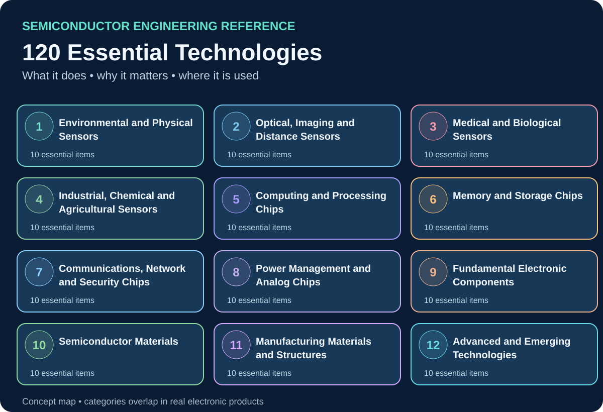

## Quick navigation

- [01. Environmental and Physical Sensors](#1-environmental-and-physical-sensors)
- [02. Optical, Imaging and Distance Sensors](#2-optical-imaging-and-distance-sensors)
- [03. Medical and Biological Sensors](#3-medical-and-biological-sensors)
- [04. Industrial, Chemical and Agricultural Sensors](#4-industrial-chemical-and-agricultural-sensors)
- [05. Computing and Processing Chips](#5-computing-and-processing-chips)
- [06. Memory and Storage Chips](#6-memory-and-storage-chips)
- [07. Communications, Network and Security Chips](#7-communications-network-and-security-chips)
- [08. Power Management and Analog Chips](#8-power-management-and-analog-chips)
- [09. Fundamental Electronic Components](#9-fundamental-electronic-components)
- [10. Semiconductor Materials](#10-semiconductor-materials)
- [11. Manufacturing Materials and Structures](#11-manufacturing-materials-and-structures)
- [12. Advanced and Emerging Technologies](#12-advanced-and-emerging-technologies)

## 1. Environmental and Physical Sensors

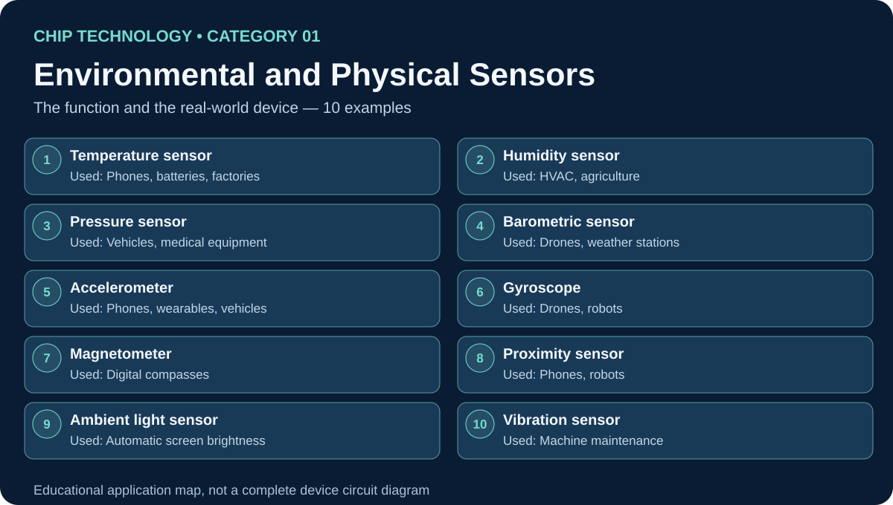

| # | Sensor, chip, or material | Purpose / function | Where used |
|---:|---|---|---|
| 1 | Temperature sensor | Measures temperature | Phones, batteries, factories |
| 2 | Humidity sensor | Measures moisture in air | HVAC, agriculture |
| 3 | Pressure sensor | Measures gas/liquid pressure | Vehicles, medical equipment |
| 4 | Barometric sensor | Measures atmospheric pressure | Drones, weather stations |
| 5 | Accelerometer | Measures acceleration and movement | Phones, wearables, vehicles |
| 6 | Gyroscope | Measures angular movement | Drones, robots |
| 7 | Magnetometer | Measures magnetic fields | Digital compasses |
| 8 | Proximity sensor | Detects nearby objects | Phones, robots |
| 9 | Ambient light sensor | Measures surrounding brightness | Automatic screen brightness |
| 10 | Vibration sensor | Detects mechanical vibrations | Machine maintenance |

## 2. Optical, Imaging and Distance Sensors

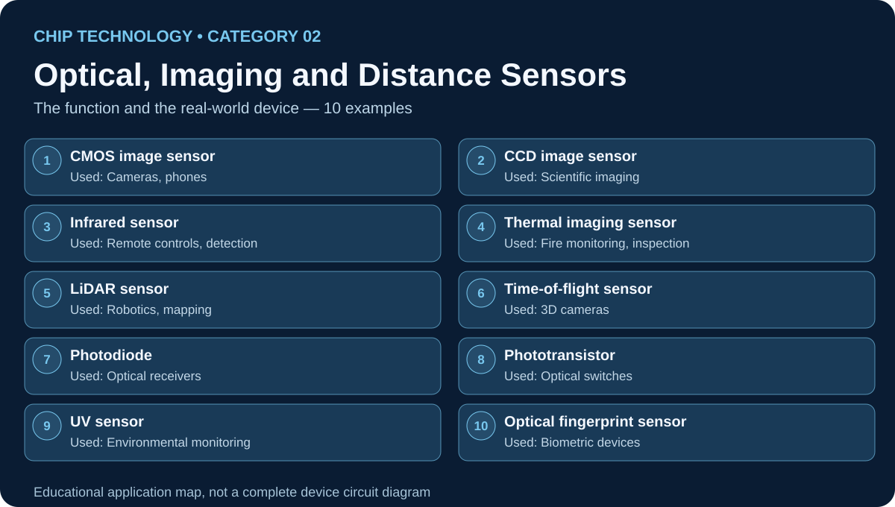

| # | Sensor, chip, or material | Purpose / function | Where used |
|---:|---|---|---|
| 11 | CMOS image sensor | Converts light into digital image data | Cameras, phones |
| 12 | CCD image sensor | Captures light using charge transfer | Scientific imaging |
| 13 | Infrared sensor | Detects infrared radiation | Remote controls, detection |
| 14 | Thermal imaging sensor | Detects infrared patterns to estimate temperatures | Fire monitoring, inspection |
| 15 | LiDAR sensor | Measures distance using light | Robotics, mapping |
| 16 | Time-of-flight sensor | Estimates distance from signal travel time | 3D cameras |
| 17 | Photodiode | Converts light into electrical current | Optical receivers |
| 18 | Phototransistor | Detects light through transistor response | Optical switches |
| 19 | UV sensor | Detects ultraviolet light | Environmental monitoring |
| 20 | Optical fingerprint sensor | Captures fingerprint images | Biometric devices |

## 3. Medical and Biological Sensors

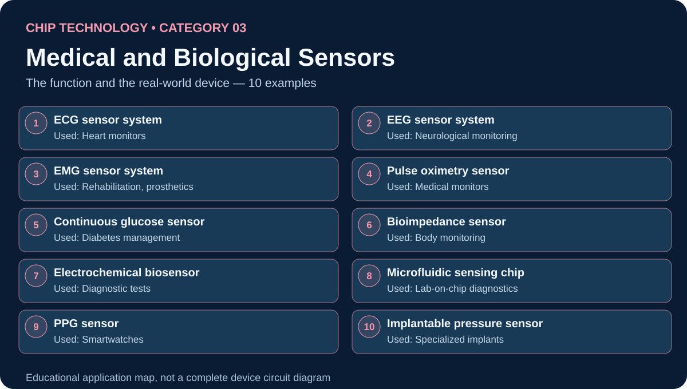

| # | Sensor, chip, or material | Purpose / function | Where used |
|---:|---|---|---|
| 21 | ECG sensor system | Measures heart electrical activity | Heart monitors |
| 22 | EEG sensor system | Measures brain electrical activity | Neurological monitoring |
| 23 | EMG sensor system | Measures muscle electrical activity | Rehabilitation, prosthetics |
| 24 | Pulse oximetry sensor | Optically estimates oxygen saturation | Medical monitors |
| 25 | Continuous glucose sensor | Measures glucose-related chemical signals | Diabetes management |
| 26 | Bioimpedance sensor | Measures electrical impedance through tissue | Body monitoring |
| 27 | Electrochemical biosensor | Detects biological or chemical substances | Diagnostic tests |
| 28 | Microfluidic sensing chip | Handles tiny liquid samples | Lab-on-chip diagnostics |
| 29 | PPG sensor | Optically measures blood-volume changes | Smartwatches |
| 30 | Implantable pressure sensor | Measures pressure inside the body | Specialized implants |

## 4. Industrial, Chemical and Agricultural Sensors

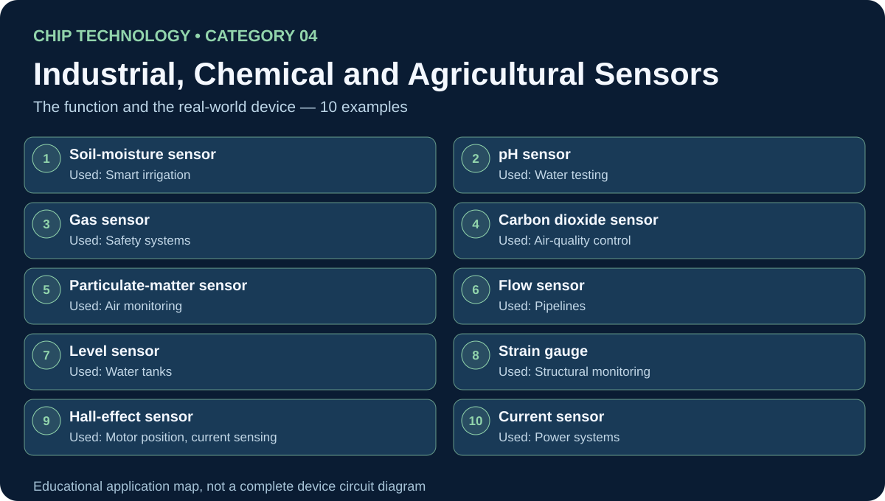

| # | Sensor, chip, or material | Purpose / function | Where used |
|---:|---|---|---|
| 31 | Soil-moisture sensor | Measures soil moisture | Smart irrigation |
| 32 | pH sensor | Measures acidity/alkalinity | Water testing |
| 33 | Gas sensor | Detects selected gases | Safety systems |
| 34 | Carbon dioxide sensor | Measures CO2 concentration | Air-quality control |
| 35 | Particulate-matter sensor | Measures airborne particles | Air monitoring |
| 36 | Flow sensor | Measures liquid/gas flow | Pipelines |
| 37 | Level sensor | Measures liquid or material level | Water tanks |
| 38 | Strain gauge | Measures deformation by resistance changes | Structural monitoring |
| 39 | Hall-effect sensor | Measures magnetic fields | Motor position, current sensing |
| 40 | Current sensor | Measures electric current | Power systems |

## 5. Computing and Processing Chips

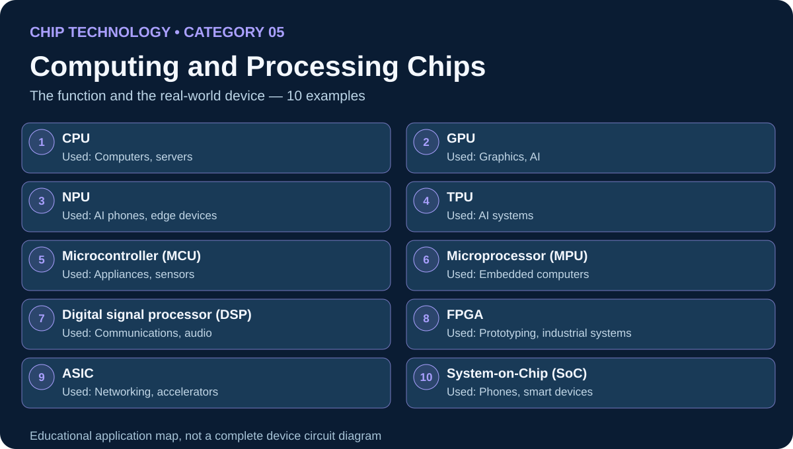

| # | Sensor, chip, or material | Purpose / function | Where used |
|---:|---|---|---|
| 41 | CPU | Executes general instructions | Computers, servers |
| 42 | GPU | Performs highly parallel calculations | Graphics, AI |
| 43 | NPU | Accelerates supported neural network operations | AI phones, edge devices |
| 44 | TPU | Specialized tensor-computation architecture | AI systems |
| 45 | Microcontroller (MCU) | Controls embedded equipment | Appliances, sensors |
| 46 | Microprocessor (MPU) | Runs application programs with external resources | Embedded computers |
| 47 | Digital signal processor (DSP) | Processes audio and sampled signals | Communications, audio |
| 48 | FPGA | Implements reconfigurable digital logic | Prototyping, industrial systems |
| 49 | ASIC | Custom chip for a specific application | Networking, accelerators |
| 50 | System-on-Chip (SoC) | Integrates multiple functions on one chip | Phones, smart devices |

## 6. Memory and Storage Chips

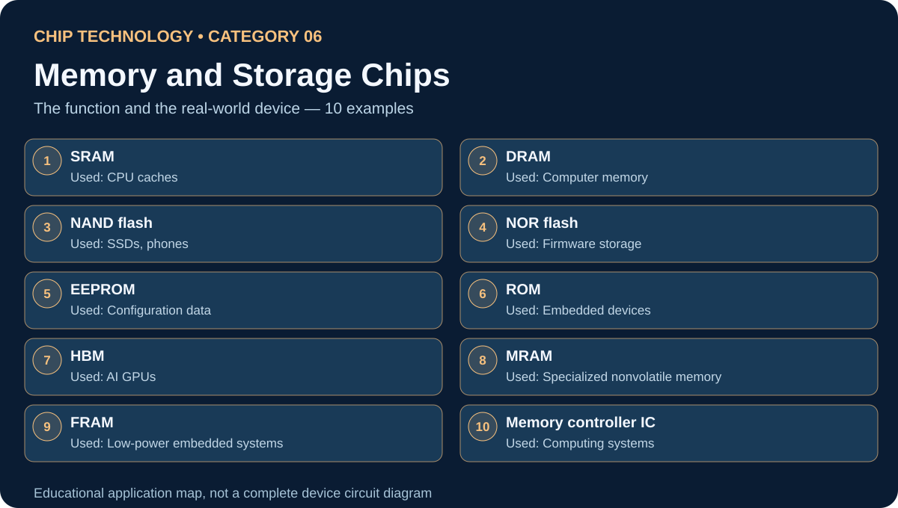

| # | Sensor, chip, or material | Purpose / function | Where used |
|---:|---|---|---|
| 51 | SRAM | Stores fast-access volatile data | CPU caches |
| 52 | DRAM | Stores active working data | Computer memory |
| 53 | NAND flash | Provides high-density nonvolatile storage | SSDs, phones |
| 54 | NOR flash | Provides nonvolatile storage with code access | Firmware storage |
| 55 | EEPROM | Electrically rewritable nonvolatile memory | Configuration data |
| 56 | ROM | Stores fixed information | Embedded devices |
| 57 | HBM | High-bandwidth stacked DRAM | AI GPUs |
| 58 | MRAM | Stores data using magnetic states | Specialized nonvolatile memory |
| 59 | FRAM | Uses ferroelectric effects to store data | Low-power embedded systems |
| 60 | Memory controller IC | Coordinates memory read/write operations | Computing systems |

## 7. Communications, Network and Security Chips

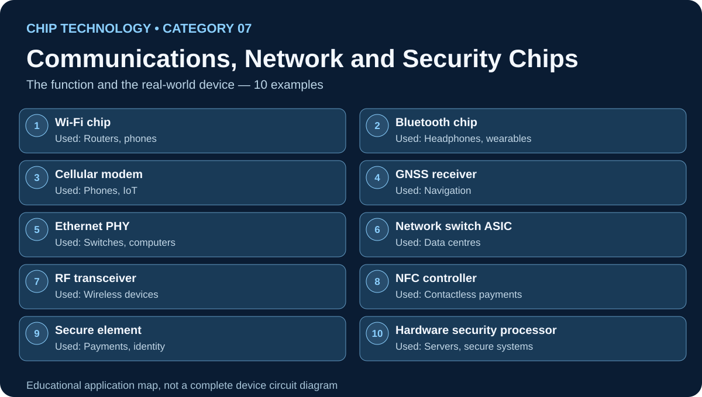

| # | Sensor, chip, or material | Purpose / function | Where used |
|---:|---|---|---|
| 61 | Wi-Fi chip | Provides wireless local networking | Routers, phones |
| 62 | Bluetooth chip | Enables short-range wireless links | Headphones, wearables |
| 63 | Cellular modem | Connects devices to mobile networks | Phones, IoT |
| 64 | GNSS receiver | Calculates location using satellite signals | Navigation |
| 65 | Ethernet PHY | Handles physical-layer network signals | Switches, computers |
| 66 | Network switch ASIC | Forwards packets between network ports | Data centres |
| 67 | RF transceiver | Transmits/receives radio signals | Wireless devices |
| 68 | NFC controller | Supports very-short-range communication | Contactless payments |
| 69 | Secure element | Protects cryptographic keys and operations | Payments, identity |
| 70 | Hardware security processor | Accelerates/isolates security functions | Servers, secure systems |

## 8. Power Management and Analog Chips

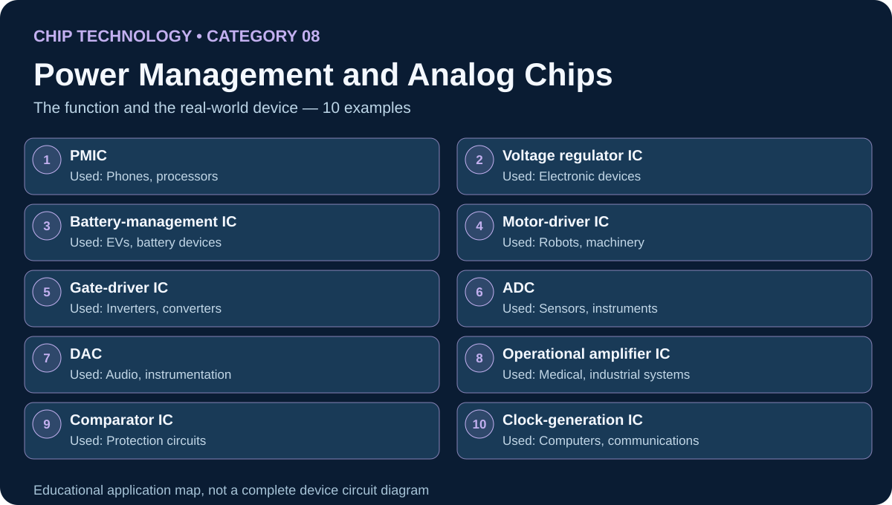

| # | Sensor, chip, or material | Purpose / function | Where used |
|---:|---|---|---|
| 71 | PMIC | Manages power rails and power states | Phones, processors |
| 72 | Voltage regulator IC | Maintains desired supply voltage | Electronic devices |
| 73 | Battery-management IC | Measures and protects battery cells | EVs, battery devices |
| 74 | Motor-driver IC | Controls current through motors | Robots, machinery |
| 75 | Gate-driver IC | Drives power-transistor gates | Inverters, converters |
| 76 | ADC | Converts analog signals to digital values | Sensors, instruments |
| 77 | DAC | Converts digital data to analog output | Audio, instrumentation |
| 78 | Operational amplifier IC | Amplifies/conditions analog signals | Medical, industrial systems |
| 79 | Comparator IC | Compares two voltages | Protection circuits |
| 80 | Clock-generation IC | Generates timing reference signals | Computers, communications |

## 9. Fundamental Electronic Components

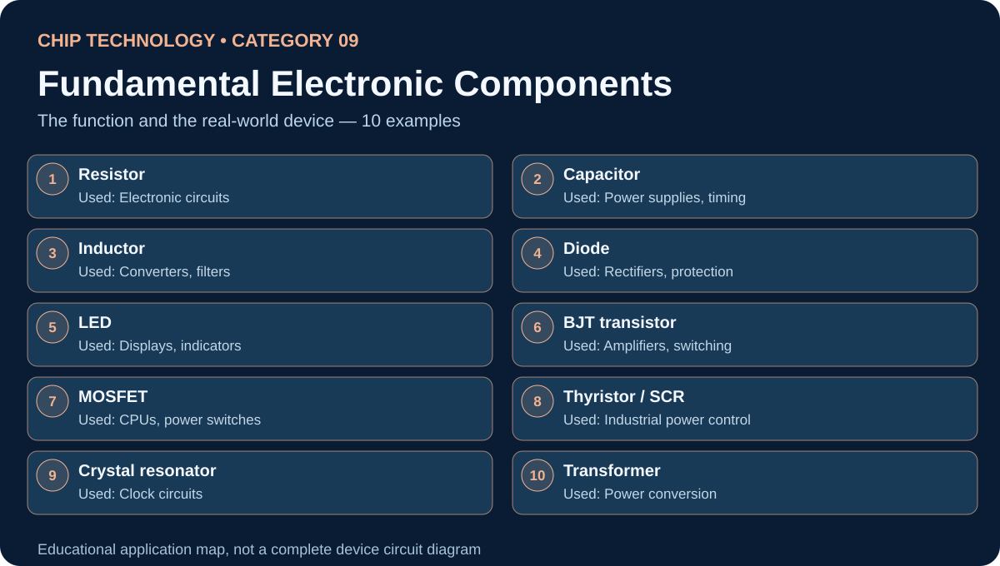

| # | Sensor, chip, or material | Purpose / function | Where used |
|---:|---|---|---|
| 81 | Resistor | Limits current or divides voltage | Electronic circuits |
| 82 | Capacitor | Stores charge and filters signals | Power supplies, timing |
| 83 | Inductor | Stores energy in a magnetic field | Converters, filters |
| 84 | Diode | Primarily conducts in one direction | Rectifiers, protection |
| 85 | LED | Emits light when driven | Displays, indicators |
| 86 | BJT transistor | Controls current through transistor action | Amplifiers, switching |
| 87 | MOSFET | Uses gate voltage to control current | CPUs, power switches |
| 88 | Thyristor / SCR | Operates as a latching power switch | Industrial power control |
| 89 | Crystal resonator | Provides stable frequency reference | Clock circuits |
| 90 | Transformer | Transfers alternating-current energy magnetically | Power conversion |

## 10. Semiconductor Materials

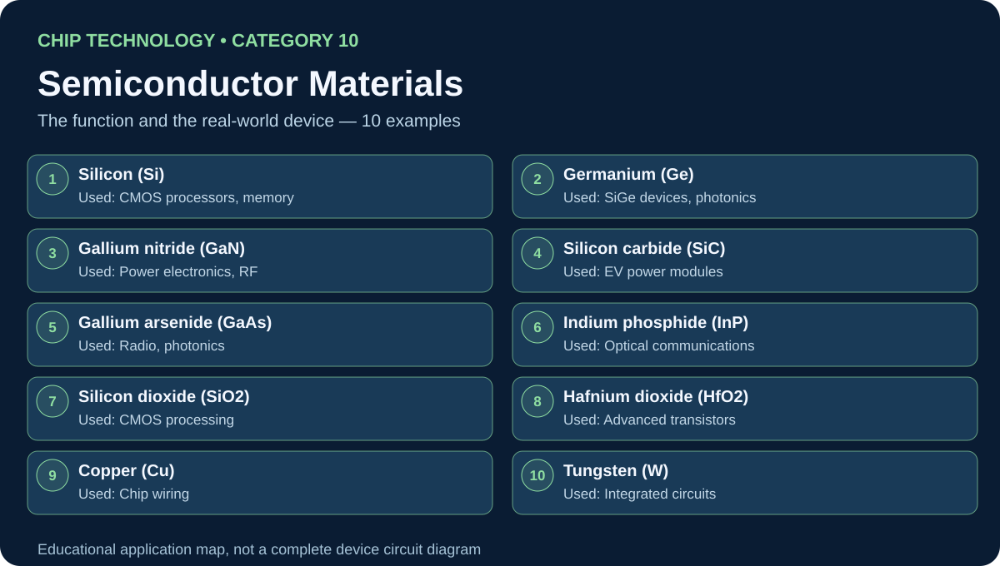

| # | Sensor, chip, or material | Purpose / function | Where used |
|---:|---|---|---|
| 91 | Silicon (Si) | Mainstream semiconductor base material | CMOS processors, memory |
| 92 | Germanium (Ge) | Semiconductor with useful carrier properties | SiGe devices, photonics |
| 93 | Gallium nitride (GaN) | Wide-bandgap semiconductor | Power electronics, RF |
| 94 | Silicon carbide (SiC) | Wide-bandgap high-voltage-capable material | EV power modules |
| 95 | Gallium arsenide (GaAs) | Compound semiconductor for RF/optoelectronics | Radio, photonics |
| 96 | Indium phosphide (InP) | High-speed optoelectronic material | Optical communications |
| 97 | Silicon dioxide (SiO2) | Electrical insulator and dielectric | CMOS processing |
| 98 | Hafnium dioxide (HfO2) | High-permittivity gate dielectric | Advanced transistors |
| 99 | Copper (Cu) | Conductive interconnect material | Chip wiring |
| 100 | Tungsten (W) | Conductive contact/interconnect metal | Integrated circuits |

## 11. Manufacturing Materials and Structures

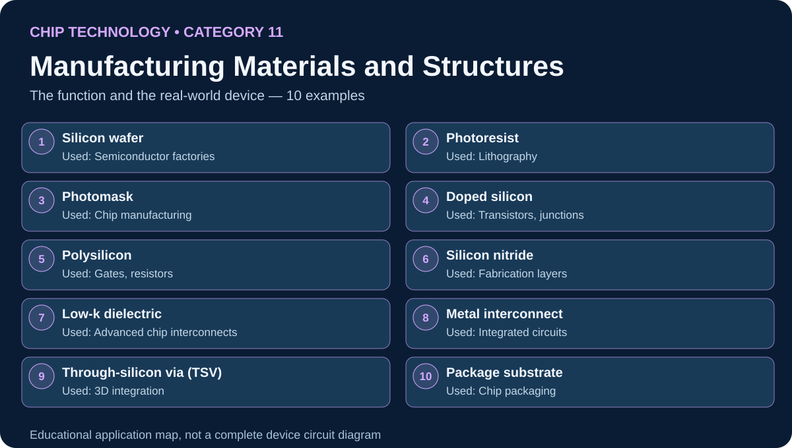

| # | Sensor, chip, or material | Purpose / function | Where used |
|---:|---|---|---|
| 101 | Silicon wafer | Substrate for fabricating many semiconductor dies | Semiconductor factories |
| 102 | Photoresist | Light-sensitive patterning material | Lithography |
| 103 | Photomask | Transfers designed patterns during exposure | Chip manufacturing |
| 104 | Doped silicon | Changes carrier concentrations and conductivity | Transistors, junctions |
| 105 | Polysilicon | Semiconductor film used in selected structures | Gates, resistors |
| 106 | Silicon nitride | Insulating/protective dielectric | Fabrication layers |
| 107 | Low-k dielectric | Reduces capacitance between wires | Advanced chip interconnects |
| 108 | Metal interconnect | Electrically connects devices on the die | Integrated circuits |
| 109 | Through-silicon via (TSV) | Connects vertically stacked dies | 3D integration |
| 110 | Package substrate | Connects die connections to a circuit board | Chip packaging |

## 12. Advanced and Emerging Technologies

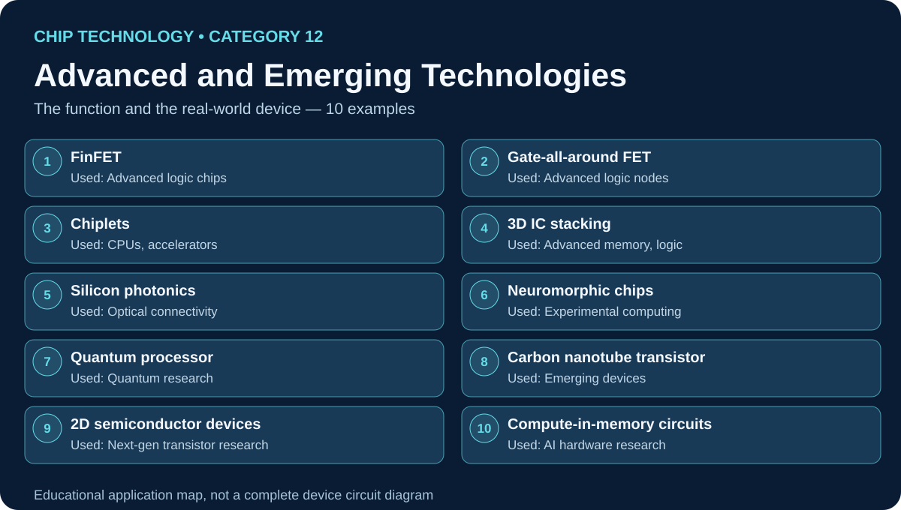

| # | Sensor, chip, or material | Purpose / function | Where used |
|---:|---|---|---|
| 111 | FinFET | Transistor with gate controlling a raised fin | Advanced logic chips |
| 112 | Gate-all-around FET | Gate surrounds channel structures | Advanced logic nodes |
| 113 | Chiplets | Combine specialized dies in one package | CPUs, accelerators |
| 114 | 3D IC stacking | Integrates chip circuits vertically | Advanced memory, logic |
| 115 | Silicon photonics | Integrates optical components on silicon platforms | Optical connectivity |
| 116 | Neuromorphic chips | Support brain-inspired event processing | Experimental computing |
| 117 | Quantum processor | Manipulates qubits for specialized algorithms | Quantum research |
| 118 | Carbon nanotube transistor | Uses nanotubes as conducting channels | Emerging devices |
| 119 | 2D semiconductor devices | Use atomically thin semiconducting material | Next-gen transistor research |
| 120 | Compute-in-memory circuits | Perform selected operations near/in memory arrays | AI hardware research |

## Practical example: Sensor-controlled robot

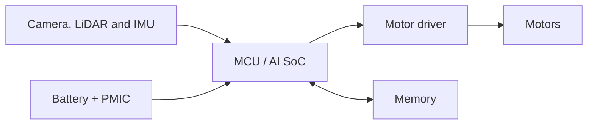

- **Sense:** Camera captures images; LiDAR measures distances; IMU estimates movement.
- **Process:** MCU or SoC interprets the measurements and chooses an action.
- **Power and act:** PMIC regulates power, and the motor driver controls the motors.
- **Verify:** Test obstacle recognition, latency, motor-control response and fault handling.

## Recommended study order

1. Components and semiconductor materials
2. Environmental and optical sensors
3. Analog interfaces: ADC, DAC, amplifiers and power control
4. Digital logic, microcontrollers, processors and memory
5. Communications, secure hardware and embedded systems
6. IC design, advanced devices and semiconductor manufacturing

## Notes on engineering use

Medical sensors require suitable clinical validation. RF devices and high-power systems require relevant regulatory and safety controls. Nanotechnology, fabrication, and advanced device research need specialist facilities. Diagrams show conceptual roles rather than verified electrical schematics.

**Related:** [180-day curriculum](../../CURRICULUM.md) · [140 engineering topics](../../engineering-phases/README.md) · [100 practical problems](../100-real-world-problems-chip-technology.md)
