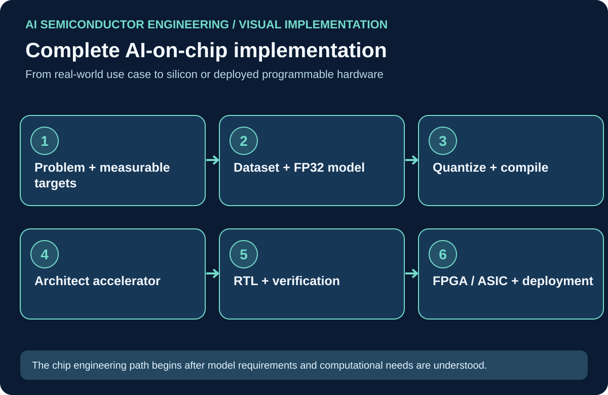
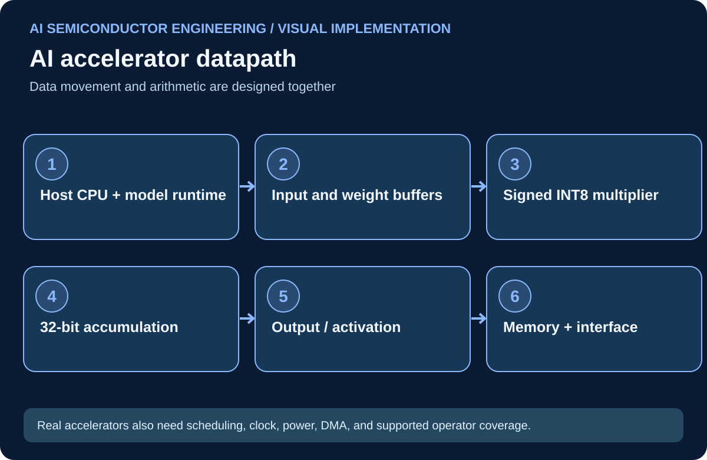
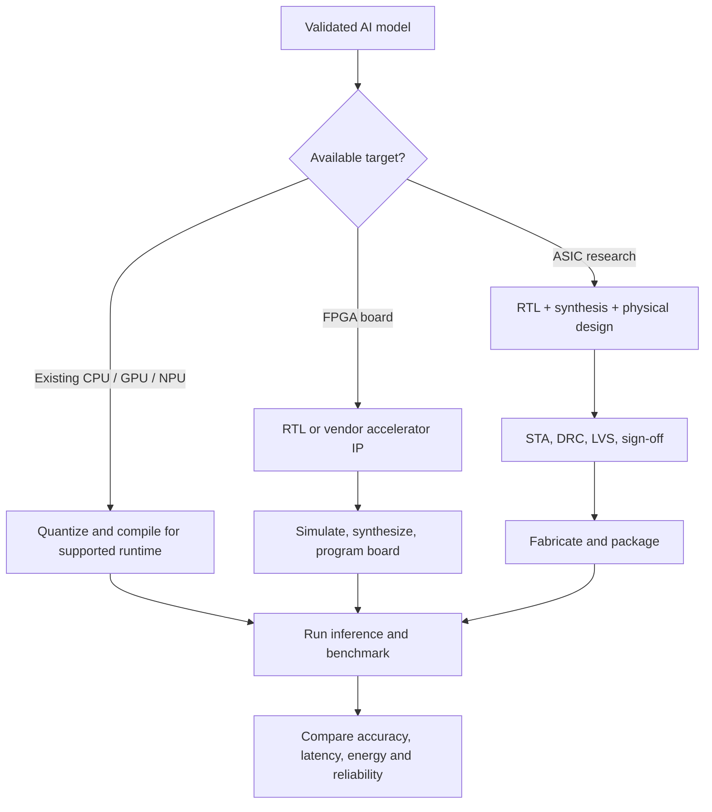
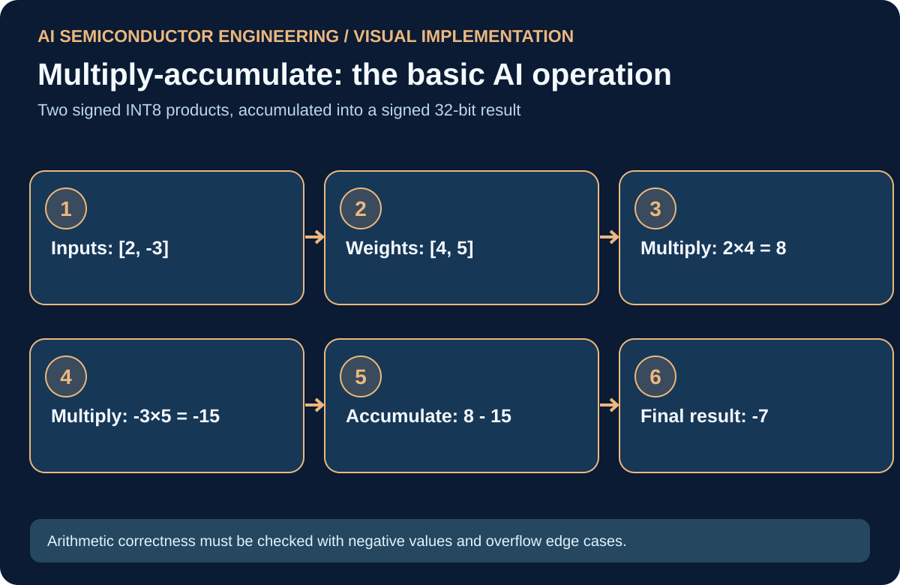
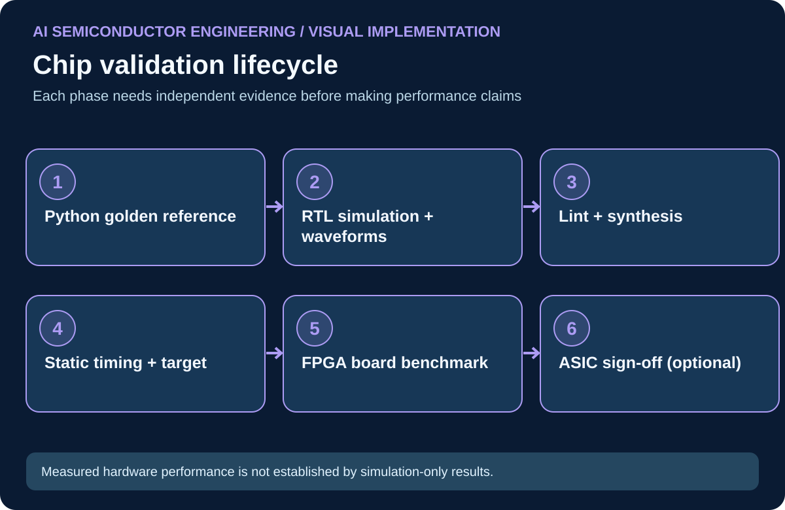
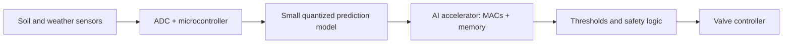

# End-to-End AI Implementation on a Chip

**Visual engineering implementation guide | model → quantization → architecture → RTL → verification → deployment**

> This is a runnable *educational reference design*, not a manufactured AI chip. The included Python model runs with the standard library. The RTL and testbench are provided for a compatible Verilog simulator; real FPGA/ASIC results require additional toolchains, hardware and validation.



## 1. What are we actually building?

**Problem:** Run small neural-network arithmetic efficiently on edge hardware.

**Concrete prototype:** A two-element signed **INT8 dot-product MAC**. It computes:

```text
result = a0*b0 + a1*b1

Example: [2, -3] dot [4, 5] = 8 - 15 = -7
```

The mathematical operation is fundamental to convolutions, dense layers and matrix multiplication. Real AI chips need thousands of additional design decisions.

**Definition of done for this reference:**
- [x] Software model and automated checks provided.
- [x] RTL implementation and self-checking testbench provided.
- [ ] Simulator execution and waveforms verified on user's machine.
- [ ] Synthesized netlist and timing/power reports verified.
- [ ] FPGA board demo performed.
- [ ] ASIC implementation or silicon measurements performed.



## 2. End-to-end phases: inputs, tools, outputs

| Step | Engineering task | Input → output | Practical check |
|---:|---|---|---|
| 01 | Define use case | Requirements → measurable targets | Define accuracy, response time, energy, cost |
| 02 | Gather & prepare data | Representative samples → train/validation/test sets | Avoid leakage, inspect coverage |
| 03 | Train baseline model | Dataset → FP32 weights | Record task metric and inference latency |
| 04 | Export model | Model → ONNX or framework graph | Verify outputs on representative inputs |
| 05 | Optimize / quantize | FP32 → INT8/mixed precision | Re-evaluate accuracy; calibrate activations |
| 06 | Analyze operators | Graph → MAC, activation, memory needs | Check shapes, unsupported ops |
| 07 | Select hardware target | Workload → CPU, NPU, FPGA or ASIC plan | Check memory/precision/tool compatibility |
| 08 | Architect datapath | Ops → PEs, SRAM, DMA, controller | Estimate arithmetic intensity and bandwidth |
| 09 | Model arithmetic | Quantized inputs → exact golden outputs | Cover negative values and accumulator overflow |
| 10 | Implement RTL | Specification → Verilog/SystemVerilog | Simulate all key cases |
| 11 | Verify interfaces | RTL → testbench, assertions, traces | Check valid, reset, latency and protocol |
| 12 | Synthesize & time | RTL + constraints → netlist/reports | Inspect cell counts, slack, inferred memories |
| 13 | Prototype on FPGA | Bitstream → physical board | Measure end-to-end time and power |
| 14 | Integrate software | Host driver/runtime → accelerator calls | Check correct CPU fallback |
| 15 | Physical ASIC flow (optional) | Netlist → placed/routed layout | DRC/LVS/timing/PDK-specific checks |
| 16 | Manufacture/test (optional) | Sign-off design → packaged silicon | Wafer probe, reliability and production tests |
| 17 | Deploy & maintain | Integrated product → field operation | Monitor drift, upgrades, safety and security |

### Which route should you choose?



## 3. Model arithmetic and quantization

Typical quantization maps a floating-point value `x` to an integer `q`:

```text
q = clamp(round(x / scale) + zero_point, qmin, qmax)
x_approx = scale * (q - zero_point)
```

For example, signed INT8 usually uses integers from **-128 through 127**. The range and scale must be chosen for the model's actual statistics; input/weight scales may differ.

- **Static quantization:** Estimate activation ranges from representative calibration data.
- **Dynamic quantization:** Compute certain parameters during execution.
- **Quantization-aware training:** Account for quantization effects during training.
- **Mixed precision:** Keep sensitive operations at higher precision if necessary.

**Never assume INT8 is accurate enough without comparing against the baseline.** The included dot-product prototype intentionally starts *after* quantization, with signed integer inputs, to isolate the hardware arithmetic.

References: [ONNX Runtime Quantization](https://onnxruntime.ai/docs/how-to/quantization.html) and [AMD Vitis AI workflow](https://vitisai.docs.amd.com/projects/gen2/en/latest/index.html).

## 4. Inside a small AI accelerator



**Main blocks:**

| Hardware block | Function | Design concern |
|---|---|---|
| Input register / SRAM | Holds activations | Capacity, read bandwidth |
| Weight storage | Holds quantized weights | Data reuse and loading |
| Multiplier | Computes signed INT8 × INT8 | Product width and sign extension |
| Accumulator | Sums products | Wider signed result, overflow policy |
| Controller / FSM | Sequences operations | Reset, handshake and determinism |
| Interface | Connects CPU / DMA / memory | Valid/ready semantics |
| Output register | Holds final result | Exact timing and transfer |
| Clock and reset | Coordinates operations | Timing closure, reset release |
| Power network | Powers switching circuits | Dynamic power, IR drop and thermals |

**Numerical sizing:** An 8-bit signed product fits in a signed 16-bit result. Two such products are accumulated in a **signed 32-bit register** in this teaching design. A complete model must define rounding, saturation, accumulation range and quantized output scaling.

## 5. The included runnable prototype

Project files:

```text
end-to-end-ai-on-chip-implementation/
├── README.md
├── images/
│   ├── 01-full-flow.svg
│   ├── 02-ai-accelerator-datapath.svg
│   ├── 03-mac-operation.svg
│   └── 04-validation-lifecycle.svg
├── software/
│   └── mac_reference.py
└── rtl/
    ├── int8_dot2.v
    └── tb_int8_dot2.v
```

### Step A — Run the software golden reference (Python 3 only)

At repository root:

```bash
python3 research/end-to-end-ai-on-chip-implementation/software/mac_reference.py
```

Expected final line: `All software reference tests passed!`

This tests **all 65,536 pairs of unsigned byte patterns?** No. The actual test uses **deterministic edge vectors and 2,000 pseudorandom signed INT8 cases**; it is a bounded educational test suite, not exhaustive proof.

### Step B — Simulate RTL (optional tool install)

With **Icarus Verilog** installed:

```bash
cd research/end-to-end-ai-on-chip-implementation
iverilog -g2012 -o /tmp/int8_dot2_tb rtl/int8_dot2.v rtl/tb_int8_dot2.v
vvp /tmp/int8_dot2_tb
```

Expected final line: `All RTL tests passed!` (only after actually running it in your environment).

The testbench writes `int8_dot2.vcd` for GTKWave. Compare every RTL output to the Python mathematical rule, and verify reset plus `valid` timing.

### Step C — Synthesis (later)

With Yosys available, use a compatible ASIC-neutral flow to inspect a generic synthesized netlist:

```bash
yosys -p 'read_verilog rtl/int8_dot2.v; hierarchy -top int8_dot2; proc; opt; synth -top int8_dot2; stat'
```

This does **not** establish silicon area, power or routed timing. Real FPGA/ASIC flows need target technology libraries and timing constraints.



## 6. Extending the prototype into a real AI inference system

1. **Choose a small real model**: e.g. keyword detection or simple image classification; record dataset and licensing.
2. **Train and freeze a baseline**: save preprocessing, weights, metrics and test split.
3. **Quantize and calibrate**: verify task accuracy with representative inputs.
4. **Create a graph compiler/mapping**: translate supported operations to accelerator instructions or a tiled schedule.
5. **Expand the MAC datapath**: add multiple processing elements and input/weight buffers.
6. **Add activation and requantization**: define integer rounding and saturation consistently with the runtime.
7. **Build a memory subsystem**: SRAM/BRAM, DMA, address mapping, host registers and backpressure.
8. **Add software integration**: CPU driver, buffer allocation, model dispatch, error handling and fallback.
9. **Verify end to end**: preprocessing → chip arithmetic → postprocessing; compare outputs with model golden data.
10. **Benchmark honestly**: batch size, model accuracy, end-to-end latency, throughput, memory, measured device power and thermal conditions.

**The current RTL only implements a two-element MAC.** It cannot directly execute arbitrary ONNX models or replace a commercial NPU. A genuine model-to-hardware compiler and system integration are still engineering work.

## 7. Hardware-to-silicon path (optional, later)

```text
RTL → lint → functional verification → synthesis
    → floorplanning → placement → clock-tree synthesis
    → routing → static timing analysis → DRC/LVS/sign-off
    → tapeout → fabrication → packaging → bring-up and test
```

Important deliverables: technology-specific constraints, power intent, gate-level checks as needed, manufacturability/test planning and calibrated PPA results. Tools such as [Yosys](https://yosyshq.net/yosys/) and [OpenROAD](https://openroad.readthedocs.io/) address portions of the flow. **A completed GDS file does not mean fabricated chips exist.**

## 8. Real-world deployment example: Smart irrigation edge AI



- **Input:** Soil moisture and weather readings.
- **Model:** Estimate whether irrigation is beneficial.
- **Chip:** Accelerate the numerical inference, if the model justifies it.
- **Output:** Decision passed through safety and operational constraints.
- **Validation:** Water consumed, soil-moisture stability, false decisions, maintenance cost.

For small rules-based applications, a microcontroller alone may be more economical than a custom AI accelerator.

## 9. Engineering sign-off checklist

- [ ] Model and input distributions documented
- [ ] Baseline task accuracy reproducible
- [ ] Quantization error measured
- [ ] Every supported operator specified
- [ ] Signed arithmetic, width, overflow and rounding defined
- [ ] Reference model matches RTL on shared vectors
- [ ] Reset, handshake, corner cases and timing covered
- [ ] Synthesis and static timing analyzed for a chosen target
- [ ] End-to-end workload benchmarked on target board
- [ ] Power measured or assumptions clearly marked
- [ ] Security, privacy and update paths reviewed
- [ ] Physical implementation validated if ASIC is intended

## 10. Authoritative references

- [AMD Vitis AI — model deployment flow](https://vitisai.docs.amd.com/projects/gen2/en/latest/index.html)
- [ONNX Runtime — quantization](https://onnxruntime.ai/docs/how-to/quantization.html)
- [Verilator — simulation and lint](https://verilator.org/guide/latest/overview.html)
- [Icarus Verilog](https://steveicarus.github.io/iverilog/)
- [Yosys](https://yosyshq.net/yosys/)
- [OpenROAD](https://openroad.readthedocs.io/)
- [Cocotb](https://docs.cocotb.org/)
- [MLCommons](https://mlcommons.org/benchmarks/)

**Related:** [180-day curriculum](../../CURRICULUM.md) · [140 engineering topics](../../engineering-phases/README.md) · [120 essential chip technologies](../120-essential-chip-sensors-components-and-materials/README.md)
