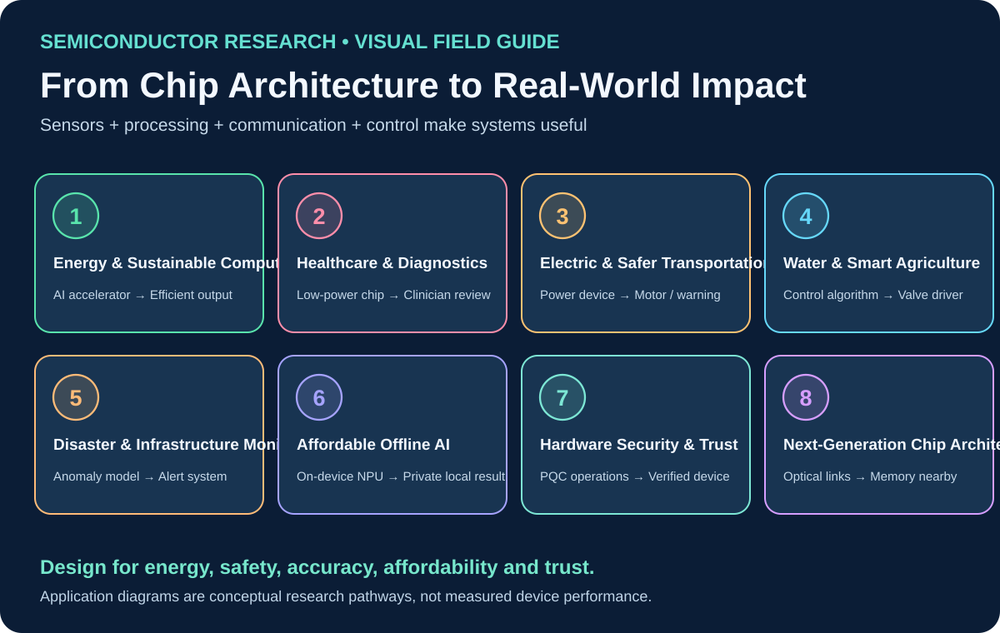
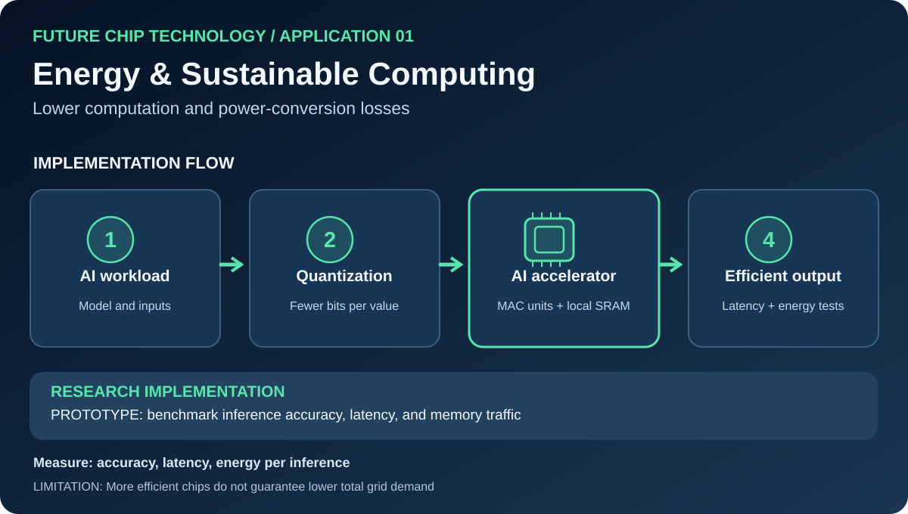
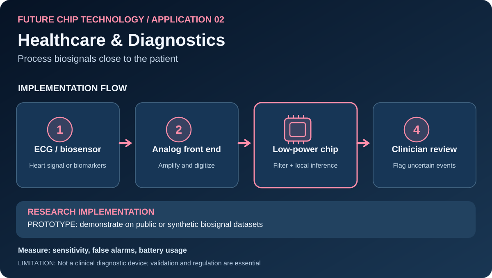
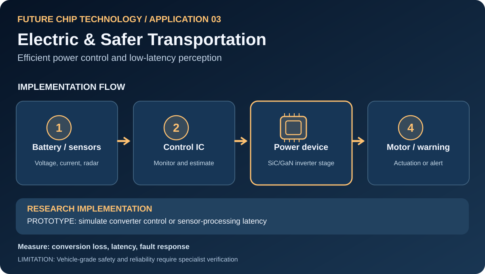
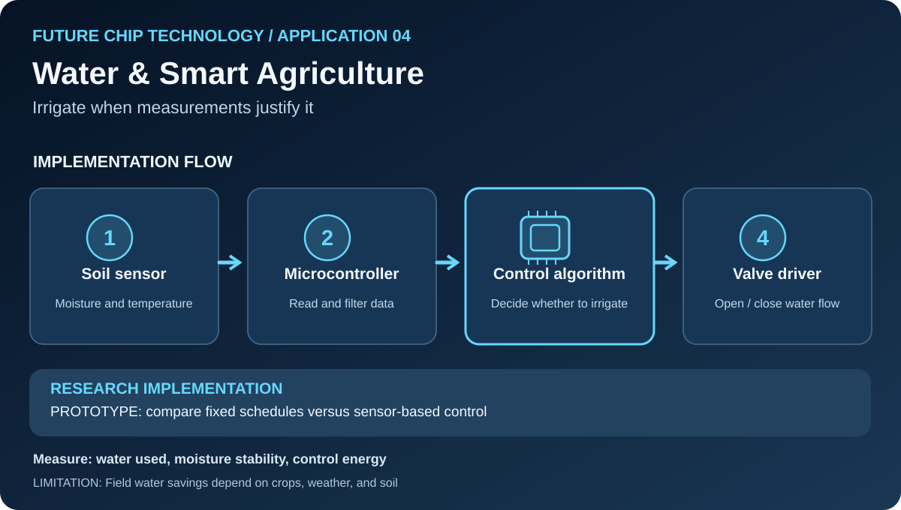
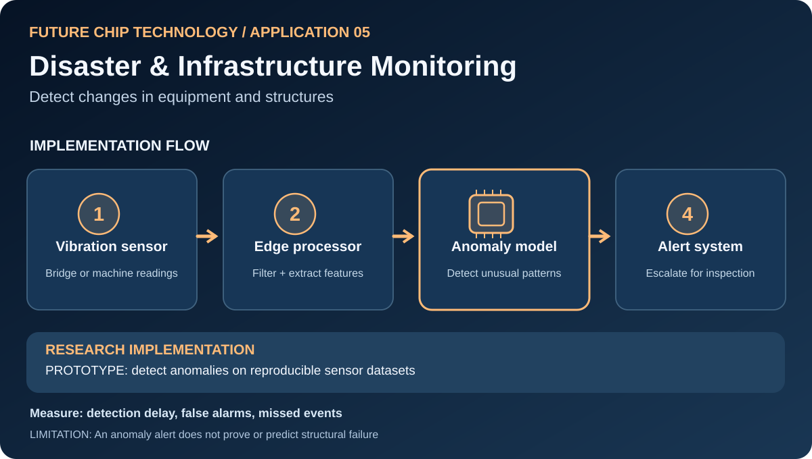
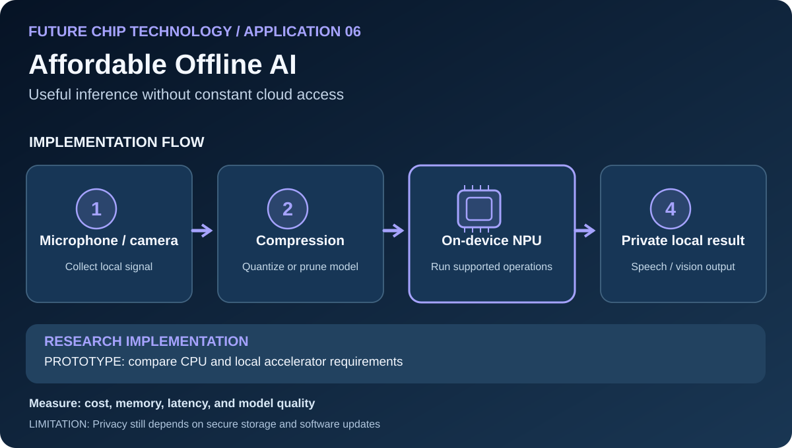
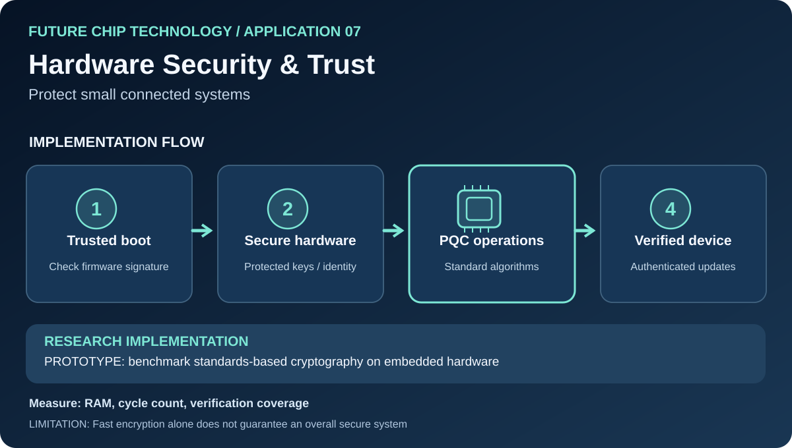
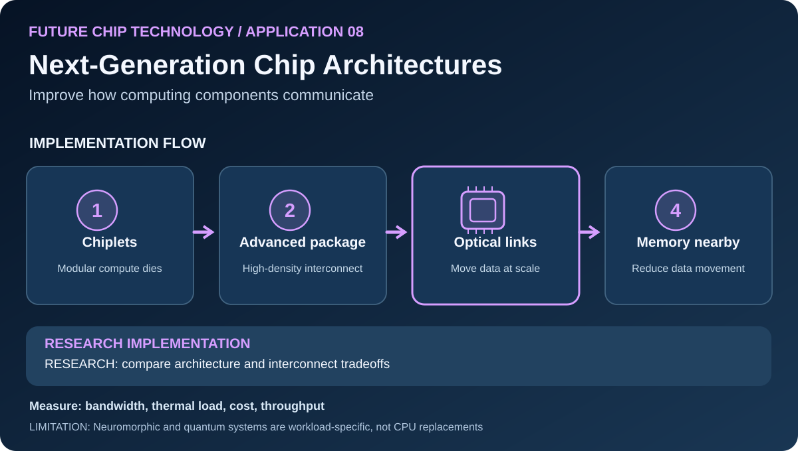

# Future Chip Technology — Real-World Problem Solving

**Visual research field guide | 2026–2040 research horizons**

Semiconductors help systems **sense → compute → decide → act**. Each illustration below shows a possible implementation and what a meaningful prototype should measure.

## 01. Energy & Sustainable Computing

**Research focus:** accuracy, latency, energy per inference. **Constraint:** More efficient chips do not guarantee lower total grid demand.

## 02. Healthcare & Diagnostics

**Research focus:** sensitivity, false alarms, battery usage. **Constraint:** Not a clinical diagnostic device; validation and regulation are essential.

## 03. Electric & Safer Transportation

**Research focus:** conversion loss, latency, fault response. **Constraint:** Vehicle-grade safety and reliability require specialist verification.

## 04. Water & Smart Agriculture

**Research focus:** water used, moisture stability, control energy. **Constraint:** Field water savings depend on crops, weather, and soil.

## 05. Disaster & Infrastructure Monitoring

**Research focus:** detection delay, false alarms, missed events. **Constraint:** An anomaly alert does not prove or predict structural failure.

## 06. Affordable Offline AI

**Research focus:** cost, memory, latency, and model quality. **Constraint:** Privacy still depends on secure storage and software updates.

## 07. Hardware Security & Trust

**Research focus:** RAM, cycle count, verification coverage. **Constraint:** Fast encryption alone does not guarantee an overall secure system.

## 08. Next-Generation Chip Architectures

**Research focus:** bandwidth, thermal load, cost, throughput. **Constraint:** Neuromorphic and quantum systems are workload-specific, not CPU replacements.

## What matters most

**A better chip is not automatically a better solution.** Compare full-system energy, performance, safety, cost, reliability and accessibility; clearly distinguish simulated prototypes from clinical, field-tested or commercial claims.

## Core research sources

- [IEA — Energy and AI](https://www.iea.org/reports/energy-and-ai) — computing energy demand and infrastructure
- [OECD — The Future of Compute](https://www.oecd.org/en/publications/oecd-digital-economy-and-society-outlook-2026_022ed474-en/full-report/powering-ai-progress-the-future-of-compute_b4007d1b.html) — compute architecture and system design
- [IEA — Global EV Outlook 2026](https://www.iea.org/reports/global-ev-outlook-2026) — electric mobility and energy systems
- [NIST — Post-Quantum Cryptography](https://csrc.nist.gov/projects/post-quantum-cryptography) — secure future systems
- [ITU — Facts and Figures](https://www.itu.int/itu-d/reports/statistics/facts-figures/) — global connectivity and access
- [IEEE Heterogeneous Integration Roadmap](https://eps.ieee.org/technology/heterogeneous-integration-roadmap/) — packaging and hardware integration

**Note:** Illustrated architectures are educational concept models. They are not hardware schematics, verified device designs, measured results or evidence of clinical effectiveness. No daily coursework was modified.
